# Final DevOps Project - StockSense

Name: Ridaa Mirza
Enrollment No: 24BCS10394

StockSense is a small inventory management app (React + FastAPI + PostgreSQL) that I used to take one application all the way from my laptop to a monitored Kubernetes cluster: tests, Docker, a CI/CD pipeline with security gates, Terraform for AWS, raw Kubernetes manifests, a Helm chart, Prometheus/Grafana, Argo CD, and a troubleshooting challenge where I broke it on purpose (and once by accident).

**Presentation:** [`StockSense-Final-Presentation.pptx`](StockSense-Final-Presentation.pptx) - 24 slides walking through the whole project, with the full explanation in the speaker notes of every slide.

Everything shown here was run for real on my MacBook (Apple Silicon, Docker Desktop, minikube with the docker driver). Every terminal screenshot is rendered from the saved output in [`outputs/`](outputs/) - nothing is typed in by hand. The few things that need AWS credentials or a `git push` are marked **TODO** with the exact commands.

---

## Contents

1. [Project overview](#1-project-overview)
2. [Architecture](#2-architecture)
3. [Technologies used](#3-technologies-used)
4. [Application setup](#4-application-setup)
5. [Docker setup](#5-docker-setup)
6. [Kubernetes deployment](#6-kubernetes-deployment)
7. [Helm deployment](#7-helm-deployment)
8. [Terraform infrastructure](#8-terraform-infrastructure)
9. [CI/CD pipeline](#9-cicd-pipeline)
10. [DevSecOps implementation](#10-devsecops-implementation)
11. [Monitoring](#11-monitoring)
12. [GitOps](#12-gitops)
13. [Troubleshooting](#13-troubleshooting)
14. [Screenshots](#14-screenshots)
15. [Lessons learned](#15-lessons-learned)
16. [Rubric checklist (GRADING.md M1-M10)](#16-rubric-checklist-gradingmd-m1-m10)
17. [TODO - what I still have to do on my machine](#17-todo---what-i-still-have-to-do-on-my-machine)

---

## 1. Project overview

The domain is my own (the rubric says the DevOps layer can follow the TaskBoard reference, the app can't): **StockSense - a warehouse inventory dashboard.**

What the app does:

- list all items (SKU, name, category, supplier, quantity, reorder level, unit price) with search and filters
- KPI cards: number of products, units on hand, low stock, out of stock, total inventory value
- add / edit / delete items, quick `+` / `-` buttons to ship or restock one unit
- a "Reorder soon" panel with a one-click restock
- each item gets a computed status: `IN_STOCK`, `LOW_STOCK` (at or below reorder level) or `OUT_OF_STOCK`

REST API (FastAPI, Swagger at `/docs`):

| Method | Path | What |
|---|---|---|
| GET | `/health` | liveness - process is up, no DB call |
| GET | `/ready` | readiness - `SELECT 1` against Postgres, 503 if it fails |
| GET | `/metrics` | Prometheus metrics |
| GET | `/api/items?q=&category=&low_stock=` | list / search / filter |
| GET | `/api/items/{id}` | one item (404 if missing) |
| POST | `/api/items` | create (409 on duplicate SKU, 422 on bad input) |
| PUT | `/api/items/{id}` | partial update |
| POST | `/api/items/{id}/adjust` | `{"delta": -3}` ship / `{"delta": 10}` restock (400 if it would go negative) |
| DELETE | `/api/items/{id}` | delete (204) |
| GET | `/api/items/stats` | KPI numbers for the dashboard |


### Folder layout

```
devops-project/
├── application/
│   ├── backend/              FastAPI app, SQLAlchemy models, Alembic migrations, pytest, Dockerfile
│   └── frontend/             React 19 + Vite 8, nginx template, Dockerfile (multi-stage)
├── docker/                   docker-compose.yml (postgres + backend + frontend) + notes
├── kubernetes/               raw manifests: namespace, ConfigMap, Secret, Postgres StatefulSet+PVC,
│                             Deployments, Services, Ingress, HPAs, probes (kustomization.yaml)
├── helm/stocksense/          Helm chart: values.yaml, values-dev.yaml, values-prod.yaml, helm test
├── terraform/                AWS VPC (2 public + 2 private subnets) + EKS with a managed node group
├── .github/workflows/        final-project.yml (the CI/CD + DevSecOps pipeline) + README
├── security/                 bandit / gitleaks / trivy configs, gate-policy.toml, gate.py
├── monitoring/               kube-prometheus-stack values, ServiceMonitor, alert rules, Grafana dashboard
├── gitops/                   Argo CD values, AppProject, Application (+ a live demo Application)
├── troubleshooting/          7 scenarios: broken/ + fixed/ YAML, real outputs, screenshots
├── scripts/                  local-pipeline.sh (CI stages on a laptop), load-test.sh (HPA)
├── outputs/                  real terminal output of every step
└── screenshots/              browser screenshots + terminal screenshots rendered from outputs/
```

Every folder has its own README with more detail: [docker](docker/README.md), [kubernetes](kubernetes/README.md), [helm](helm/README.md), [terraform](terraform/README.md), [security](security/README.md), [monitoring](monitoring/README.md), [gitops](gitops/README.md), [troubleshooting](troubleshooting/README.md), [.github/workflows](.github/workflows/README.md).

---

## 2. Architecture

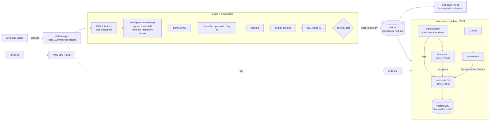

ASCII version (same thing):

```
 laptop --git push--> GitHub --> GitHub Actions (final-project.yml)
                                   |
   lint+pytest(Postgres)  frontend build  helm lint/terraform validate
                                   |
            bandit -> pip-audit/npm audit/trivy fs -> gitleaks
                                   |
            docker build (backend, frontend) -> trivy image -> SECURITY GATE
                                   |  (main only)
                       ghcr.io/ridaa10394/stocksense-*:<sha>
                                   |
                  kind cluster in CI: helm install + helm test + curl

 Terraform -> AWS: VPC (2 public + 2 private subnets, NAT) -> EKS + node group
 Argo CD  <- pulls helm/stocksense from GitHub -> keeps the cluster in sync

                    Kubernetes namespace final-app
   browser -> Ingress (stocksense.localhost)
                 |-- /     -> Service stocksense-frontend -> 2 pods (nginx, React)
                 |-- /api  -> Service stocksense-backend  -> 2..5 pods (FastAPI)  <- HPA (CPU 60%)
                                                               |
                                              Service stocksense-postgres (headless)
                                                               |
                                               StatefulSet postgres-0 + PVC (1Gi)
   Prometheus --ServiceMonitor--> backend /metrics      Grafana -> Prometheus
```

---

## 3. Technologies used

| Area | Tools (versions I actually ran) |
|---|---|
| Frontend | React 19.3, Vite 8.3, plain CSS (responsive), nginx-unprivileged 1.29-alpine |
| Backend | Python 3.12, FastAPI 0.142, SQLAlchemy 2.1, psycopg 3.3, pydantic-settings, Alembic 1.20, uvicorn |
| Database | PostgreSQL 16 (alpine) |
| Testing / quality | pytest 9.1 + pytest-cov 7.1 (80% gate), httpx TestClient, ruff 0.16 |
| Containers | Docker Desktop 29.7, Docker Compose, multi-stage builds, non-root users |
| CI/CD | GitHub Actions, actionlint 1.7.12, GHCR, kind (helm/kind-action) |
| Security | bandit 1.9.4, pip-audit 2.10.1, npm audit, trivy 0.75.0 (fs, image, config), gitleaks 8.30.1, custom gate (`gate.py`) |
| IaC | Terraform 1.16.4, AWS provider 6.67, terraform-aws-modules/vpc 6.7.3, terraform-aws-modules/eks 21.26.0 |
| Kubernetes | minikube (k8s v1.37.0), ingress-nginx, metrics-server, kustomize, StatefulSet/PVC, HPA v2 |
| Packaging | Helm 3 chart with tests |
| Monitoring | kube-prometheus-stack 92.1.0 (Prometheus 3.15, Grafana 13.2, operator 0.94), prometheus-fastapi-instrumentator |
| GitOps | Argo CD 3.5.5 (argo-cd chart 10.10.3) |

---

## 4. Application setup

### Backend

```
application/backend/
├── app/
│   ├── config.py        settings from env vars; builds DATABASE_URL from DB_HOST/DB_USER/... (k8s ConfigMap + Secret)
│   ├── db.py            engine, session, get_db dependency
│   ├── models.py        Item model + computed stock_status
│   ├── schemas.py       pydantic request/response models with validation
│   ├── main.py          routes, /health /ready /metrics, business metrics
│   └── wait_for_db.py   retry until Postgres accepts connections (used before migrations)
├── alembic/versions/    0001_create_items.py, 0002_seed_items.py (6 demo items)
├── alembic/env.py       uses a Postgres advisory lock so 2 replicas can't migrate at the same time
├── tests/               conftest.py + 19 tests (health, CRUD, validation, filters, stats, migrations, wait_for_db)
├── pytest.ini  ruff.toml  requirements.txt  requirements-dev.txt  .env.example  Dockerfile
```

Run it directly:

```bash
cd application/backend
uv venv -p 3.12 .venv && . .venv/bin/activate        # or python3.12 -m venv .venv
pip install -r requirements-dev.txt
cp .env.example .env                                  # point DATABASE_URL at a Postgres
alembic upgrade head
uvicorn app.main:app --reload --port 8000             # http://localhost:8000/docs
```

**Tests never touch a real database.** `tests/conftest.py` overrides FastAPI's `get_db` dependency with an in-memory SQLite engine (fresh tables per test). Set `TEST_DATABASE_URL` and the same tests run against a throwaway Postgres - which is what CI does with a Postgres service container. `test_migrations.py` runs the real Alembic upgrade + downgrade on a scratch database.

```bash
ruff check . && ruff format --check .
pytest -v --cov=app --cov-report=term-missing --cov-fail-under=80
```

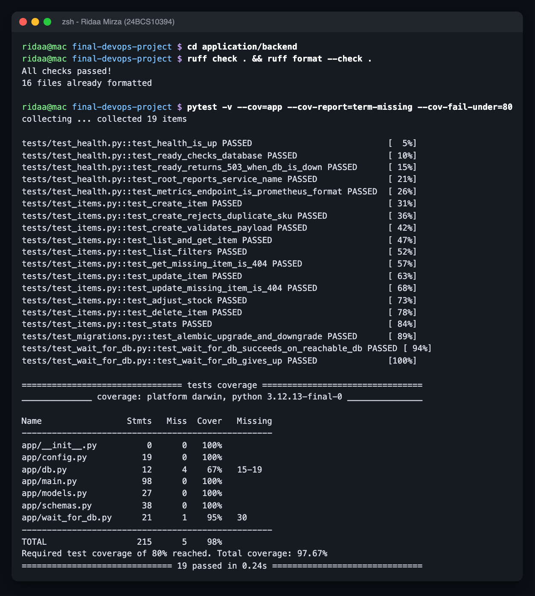

Same 19 tests against a real Postgres 16 container (what CI runs):

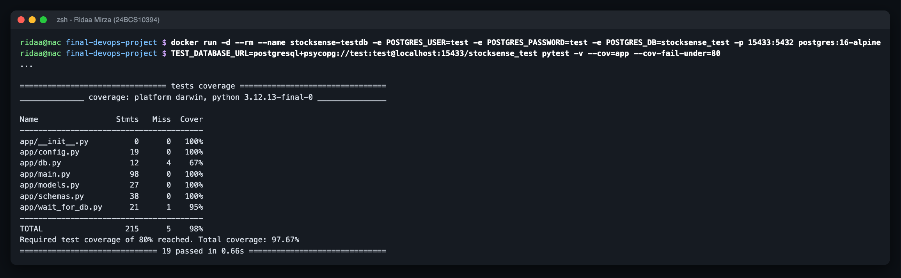

### Frontend

`application/frontend/src/App.jsx` + `api.js` + `styles.css`. All calls go to a relative `/api` path, so the browser never needs to know an internal hostname - nginx (Docker/K8s) or the Vite dev proxy forwards it.

```bash
cd application/frontend
npm ci              # exact versions from package-lock.json
npm run build       # dist/
npm run dev         # http://localhost:5173, proxies /api to localhost:8000
```

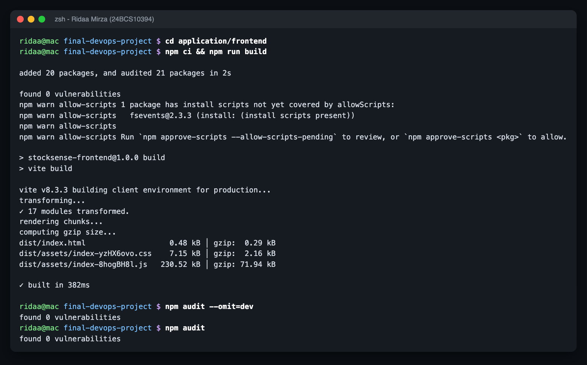

It's responsive - same page at phone width:

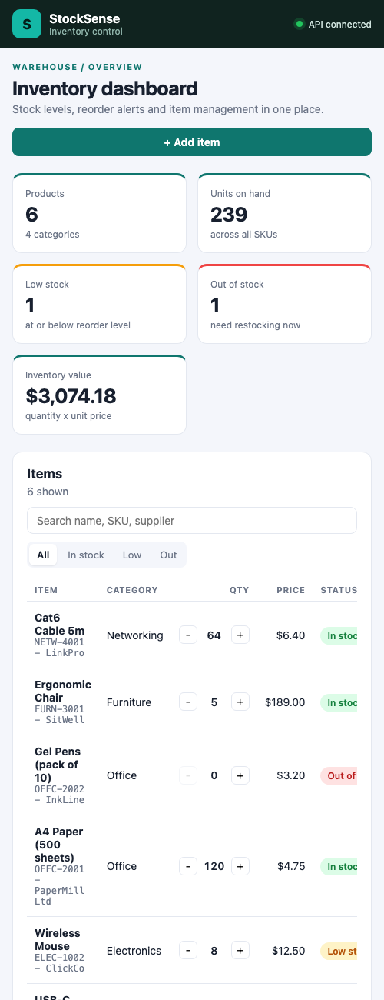

---

## 5. Docker setup

Details: [docker/README.md](docker/README.md).

- **Backend** (`application/backend/Dockerfile`): 2 stages - build a venv, copy it into a clean `python:3.12-slim`, **remove pip** from the runtime (trivy found HIGH CVEs in pip's vendored libs), run as **UID 10001**, `HEALTHCHECK` on `/health`. The entrypoint waits for the DB, runs `alembic upgrade head`, then `exec uvicorn`.
- **Frontend** (`application/frontend/Dockerfile`): **multi-stage** - `node:22-alpine` runs `npm ci && npm run build`, then only `dist/` is copied into `nginx-unprivileged:1.29-alpine` (**UID 101**, port 8080, `apk upgrade` for security fixes). The nginx config is a template, `BACKEND_URL` is filled in at start.
- **Compose** (`docker/docker-compose.yml`): postgres (healthcheck, only on `backend-net`), backend (waits for postgres healthy), frontend (waits for backend healthy).

```bash
cd docker
docker compose build --no-cache
FRONTEND_PORT=13000 BACKEND_PORT=18000 docker compose up -d --build   # 3000/8000 were taken on my Mac
```


All CRUD endpoints against the running stack (GET, POST, PUT, adjust, stats, the 409 duplicate, DELETE, then 404):


The frontend's nginx proxying `/api`, the migrated `items` table inside Postgres, and both containers running as non-root (and no `pip` in the backend image):


Swagger UI at `http://localhost:18000/docs`:

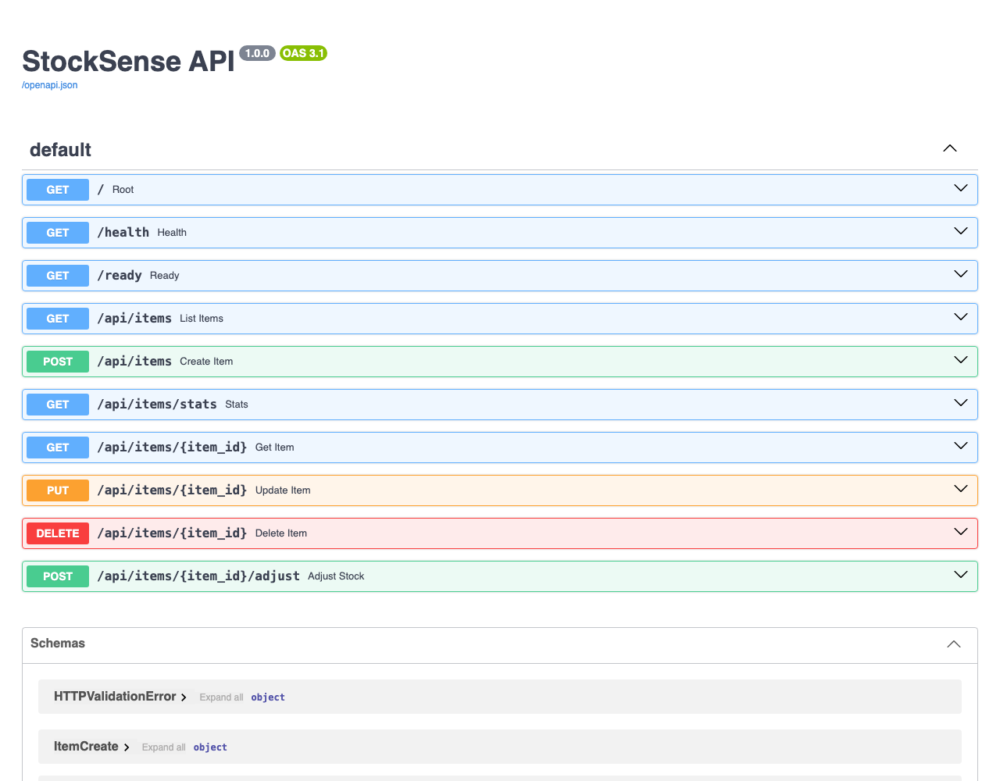

```bash
docker compose down -v
```


---

## 6. Kubernetes deployment

Details: [kubernetes/README.md](kubernetes/README.md). Namespace `final-app` on minikube (ingress + metrics-server addons).

| Requirement | Where |
|---|---|
| Namespace | `kubernetes/00-namespace.yaml` |
| ConfigMap | `01-configmap.yaml` (DB host/port/name, APP_ENV, BACKEND_URL) |
| Secret | `02-secret.yaml` (DB_USER / DB_PASSWORD, fake dev-only value) |
| Postgres StatefulSet + PVC | `03-postgres.yaml` (volumeClaimTemplates 1Gi, headless Service) |
| Deployments + Services | `04-backend.yaml`, `05-frontend.yaml` (2 replicas each, ClusterIP) |
| Probes | backend startup `/health`, readiness `/ready` (DB), liveness `/health`; frontend `/healthz`; postgres `pg_isready` |
| Ingress | `06-ingress.yaml` - `/api` -> backend:8000, `/` -> frontend:80, host `stocksense.localhost` |
| HPA | `07-hpa.yaml` - backend 2-5 @ 60% CPU, frontend 2-4 @ 70% |
| Security | all pods non-root, read-only root filesystem, all capabilities dropped, seccomp RuntimeDefault |

```bash
docker tag stocksense-backend:local stocksense-backend:1.0.0      # same for frontend
minikube image load stocksense-backend:1.0.0                      # no registry needed for minikube
kubectl apply -k kubernetes/
```

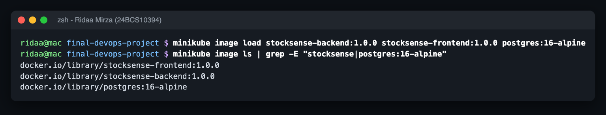

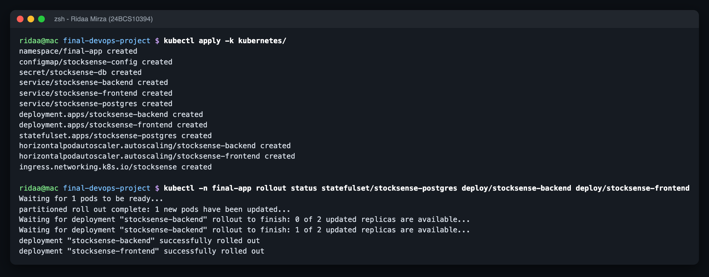

Everything that got created - Deployments 2/2, StatefulSet 1/1, Services with endpoints, Ingress, HPAs, PVC `Bound`, ConfigMap, Secret:

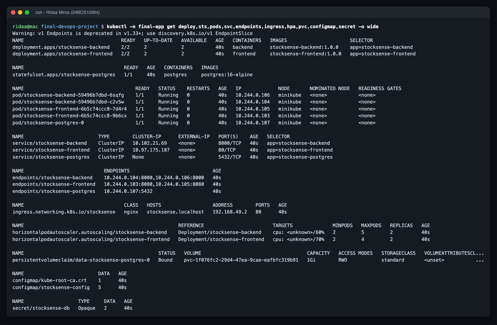

Probes on the backend pods and the `migrate` init container - both replicas wait for Postgres, only one actually runs the migration (advisory lock):

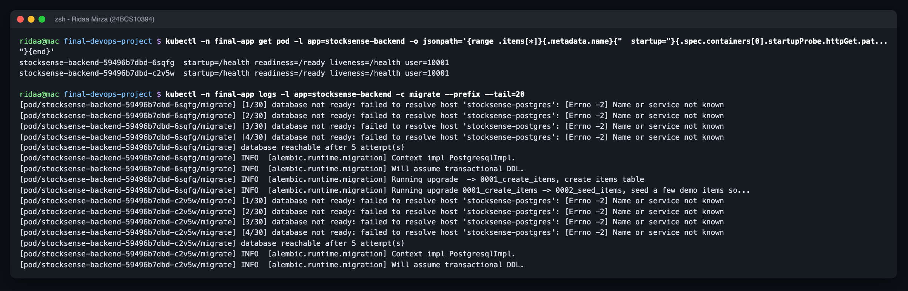

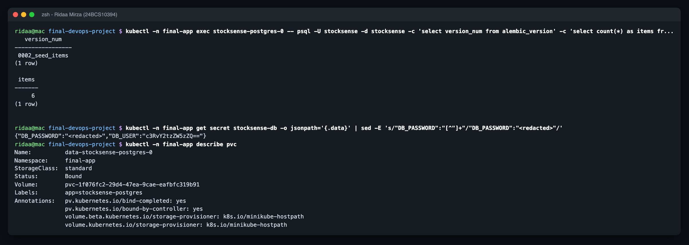

Through the Ingress from the Mac (`kubectl -n ingress-nginx port-forward svc/ingress-nginx-controller 18210:80`; `*.localhost` resolves to 127.0.0.1 on its own, so no `/etc/hosts` edit):

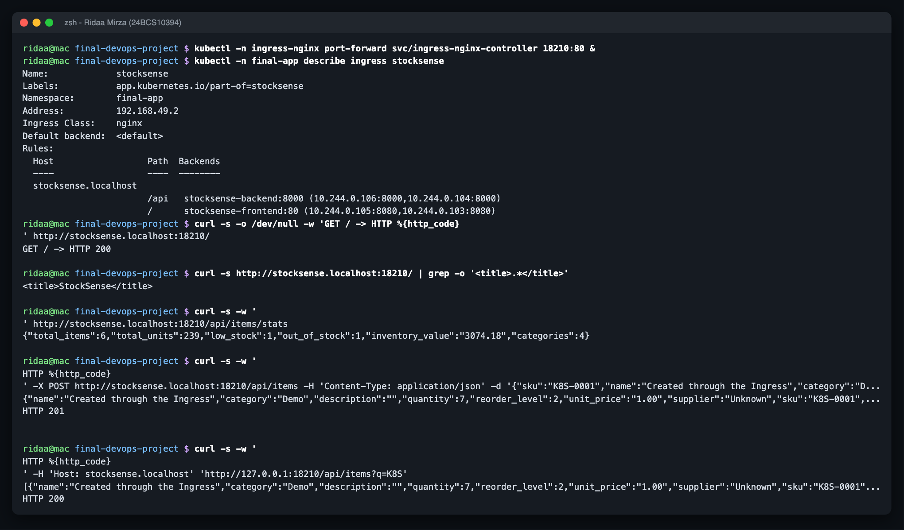

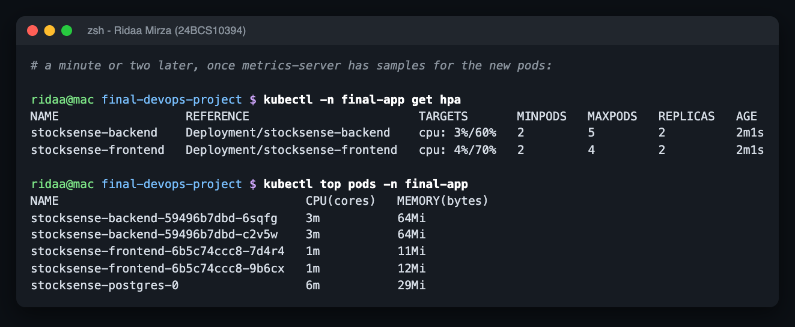

---

## 7. Helm deployment

Details: [helm/README.md](helm/README.md). The chart (`helm/stocksense`) renders everything above plus an optional ServiceMonitor, PrometheusRule and Grafana dashboard, with `values.yaml` (defaults, GHCR images), `values-dev.yaml` (minikube) and `values-prod.yaml` (EKS: existing Secret, gp3, TLS, larger HPA). CI only sets `global.imageTag=<git sha>`.

```bash
helm lint helm/stocksense -f helm/stocksense/values-dev.yaml
helm upgrade --install stocksense helm/stocksense -n final-app -f helm/stocksense/values-dev.yaml --wait
helm test stocksense -n final-app --logs
```


All pods `Running`, ClusterIP Services, Ingress, HPAs, PVC, ServiceMonitor, PrometheusRule:


`helm test` runs a pod inside the cluster that checks health, readiness, the API, `/metrics`, the frontend and the frontend's `/api` proxy:


The app through the Helm release's Ingress, with a create + update:

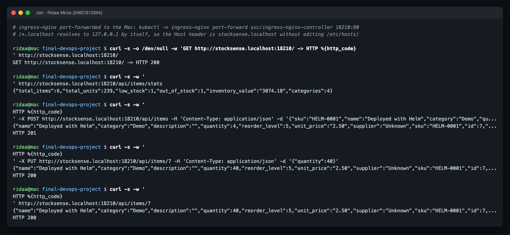

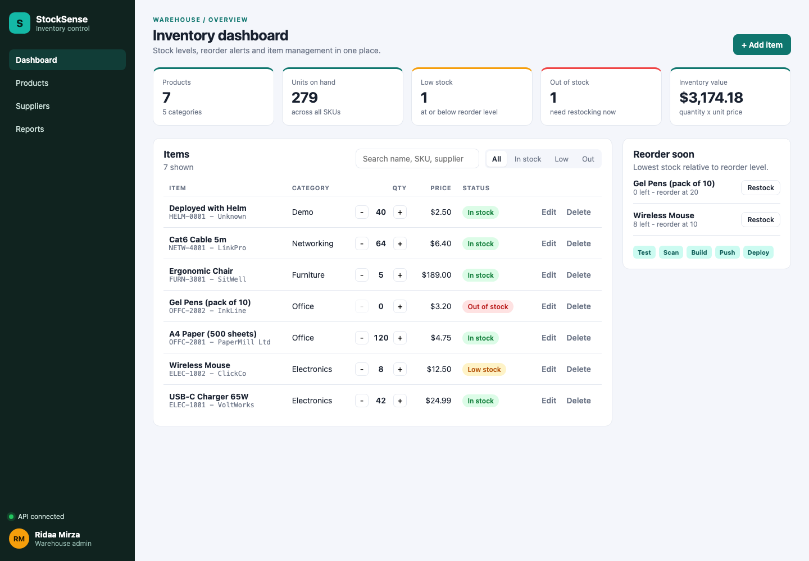

Upgrade and rollback (the `checksum/config` annotation rolled the pods automatically):


### Autoscaling (HPA) under load

`scripts/load-test.sh` starts a curl pod inside the cluster with 8 workers hammering `/api/items/stats` for 4 minutes (~73k requests). The HPA went 2 -> 5 when CPU hit 203-330% of the request, and back to 2 once the load stopped:

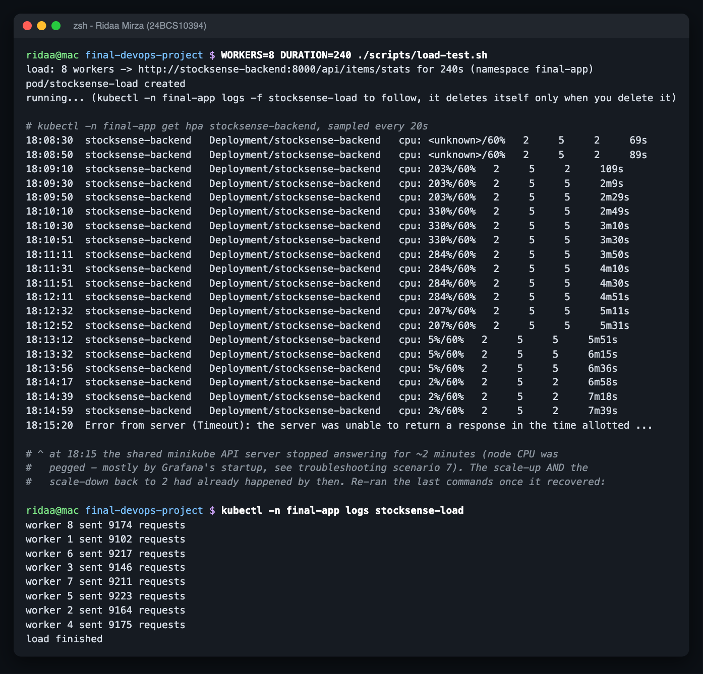

(The error line at 18:15 is the shared minikube API server stalling - that's troubleshooting scenario 7, part 2.)

---

## 8. Terraform infrastructure

Details: [terraform/README.md](terraform/README.md).

- `terraform-aws-modules/vpc` 6.7.3: VPC `10.42.0.0/16`, **2 public + 2 private subnets** across 2 AZs, IGW, one NAT gateway (cheap), ELB subnet tags.
- `terraform-aws-modules/eks` 21.26.0: EKS 1.33 in the private subnets, addons incl. metrics-server, **managed node group** t3.medium (min 1 / desired 2 / max 3, SPOT in dev), creator gets cluster-admin.
- `cluster_admin_cidrs` has no default and rejects `0.0.0.0/0` (trivy config flagged an open API endpoint).
- `terraform.tfvars.example` committed, `terraform.tfvars` / state / `.terraform` gitignored, S3 backend block ready (commented).

This machine has no AWS credentials, so `init`, `fmt` and `validate` ran for real; `plan` stops at the provider credentials, as expected:


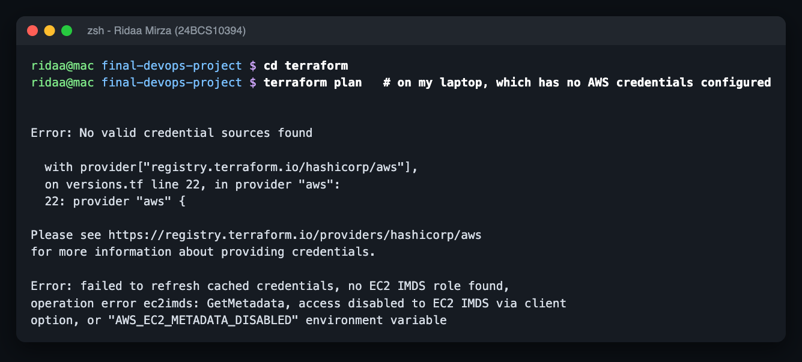

> TODO (on a machine with AWS credentials): `terraform plan`, `apply`, AWS console screenshots of the VPC and EKS cluster, then `terraform destroy` - exact commands in [section 17](#17-todo---what-i-still-have-to-do-on-my-machine) and [terraform/README.md](terraform/README.md).

---

## 9. CI/CD pipeline

The workflow is [`.github/workflows/final-project.yml`](.github/workflows/final-project.yml). It runs on every push and pull request to `main`, plus manual `workflow_dispatch`.

```
push / PR to main
 ├─ 1a backend-test    ruff, pytest -v against a Postgres service, --cov-fail-under=80, alembic up/down
 ├─ 1b frontend-build  npm ci, npm run build
 └─ 1c iac-validate    helm lint (dev + prod), kubectl kustomize, terraform fmt/init/validate, dashboard copy in sync
        │
 2  SAST            bandit -> bandit.json (+ SARIF to code scanning)
 3  SCA             pip-audit, npm audit, trivy fs (lockfiles), trivy config (IaC, report only)
 4  Secret scan     gitleaks (pinned binary, sha256-verified)
 5  Docker build    matrix backend/frontend, tag = ghcr.io/<owner lower-case>/stocksense-<c>:${GITHUB_SHA}
 6  Trivy image     matrix; JSON report + `--severity HIGH,CRITICAL --ignore-unfixed --exit-code 1`
 7  Security gate   security/gate.py over all reports
        │ (only push events on main)
 8  Push to GHCR    the exact scanned images, SHA tag only (no `latest`), GITHUB_TOKEN
 9  Deploy          kind cluster in the runner, metrics-server, helm upgrade --install, helm test, curl smoke test
```

Notes on decisions:

- Images are built **once**, saved as artifacts, scanned, and the same tarball is pushed - what was scanned is what ships.
- `${GITHUB_REPOSITORY_OWNER,,}` lower-cases `Ridaa10394` - GHCR rejects upper-case image names (the reference workflow would fail on that).
- Deploy goes to a throwaway **kind** cluster because a GitHub runner can't reach my laptop's minikube. For EKS, swap the kind step for `aws-actions/configure-aws-credentials` (OIDC) + `aws eks update-kubeconfig` - or let Argo CD pull (section 12).
- Pinned scanner binaries with sha256 checks instead of third-party wrapper actions.

The workflow passes `actionlint` (which also shellchecks every `run:` block):


`scripts/local-pipeline.sh` runs stages 1-7 on my laptop, which is where all the scan outputs below come from.

> TODO (after you push): the first green run URL, the GHCR package page showing the SHA tags, and a commit-history screenshot - see [section 17](#17-todo---what-i-still-have-to-do-on-my-machine).

---

## 10. DevSecOps implementation

Details: [security/README.md](security/README.md). One policy file (`security/gate-policy.toml`) decides what blocks a release; every scanner only reports.

The **first** run of the pipeline failed the gate - 4 fixable HIGH CVEs in the backend image (pip's vendored urllib3/msgpack/setuptools) and 42 in the frontend image (outdated Alpine packages in the nginx base):


Fixes: uninstall pip from the backend runtime image; `apk upgrade` in the frontend runtime stage. Second run - everything passes:


**What Trivy scanned and what the result means:** Trivy scanned both final images - OS packages (Debian 13 / Alpine 3.23) and the Python packages in the venv. After the fixes there are 0 HIGH/CRITICAL findings with an available fix, so the gate passes. The backend still has 44 HIGH in Debian packages with no fix released yet - for example `CVE-2026-9538` in `perl-base` (DoS via a crafted tar header in Perl's Archive::Tar, Debian status `fix_deferred`); the app never runs Perl or unpacks tar files and there's nothing to upgrade to, so it's reported and tracked rather than blocking.

Secret scanning (default rules + a custom rule for Postgres URLs with inline passwords, proven on a scratch file outside the repo):


IaC scan (trivy config) - Postgres StatefulSet hardening and the open EKS CIDR were fixed after this scan flagged them; the two remaining findings are accepted and explained in [security/README.md](security/README.md):


Other controls: non-root + read-only containers, dropped capabilities, seccomp, no secrets in Git (only `.example` files, fake dev Secret, `existingSecret` for prod), `GITHUB_TOKEN` only, least-privilege `permissions:` per job.

---

## 11. Monitoring

Details: [monitoring/README.md](monitoring/README.md). kube-prometheus-stack in `final-monitoring` with `monitoring/prometheus-values.yaml`; the app chart adds a ServiceMonitor, 5 alert rules and the Grafana dashboard (sidecar-loaded).

`/metrics` on the backend (request counters/histograms + my own `stocksense_inventory_changes_total` and `stocksense_low_stock_items`):


Prometheus picked up the ServiceMonitor; the backend targets are `up` and the StockSense alert rules are loaded:


Prometheus Targets page during the load test (HPA had scaled to 5 pods - 5/5 UP):


Grafana "StockSense - Application Overview" with live data from the load test: ~420 req/s peak, p50/p95/p99 latency, CPU per pod vs the 100m request, HPA replicas 2 -> 5 -> 2:


---

## 12. GitOps

Details: [gitops/README.md](gitops/README.md). Argo CD 3.5.5 installed with `gitops/argocd-values.yaml`.

- `gitops/argocd-application.yaml` is the real Application: chart `helm/stocksense` from `https://github.com/Ridaa10394/devops-project.git`, auto-sync with prune + self-heal, in its own AppProject.
- Before this repo was pushed, I proved the flow with `gitops/demo-application.yaml`, which points at my already-pushed Session 15 chart in my course repo `Ridaa10394/DevOps`.

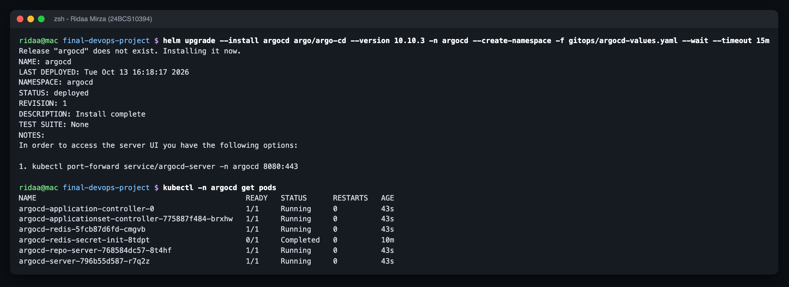

Argo CD synced the chart straight from GitHub (revision `a3e8da0` = current `main`):

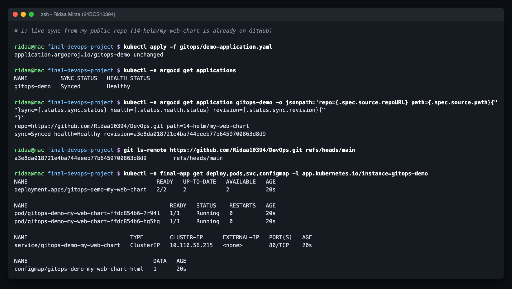

Self-heal: I scaled the Deployment to 5 by hand, Argo CD reverted it to the 2 replicas from Git about a second later:

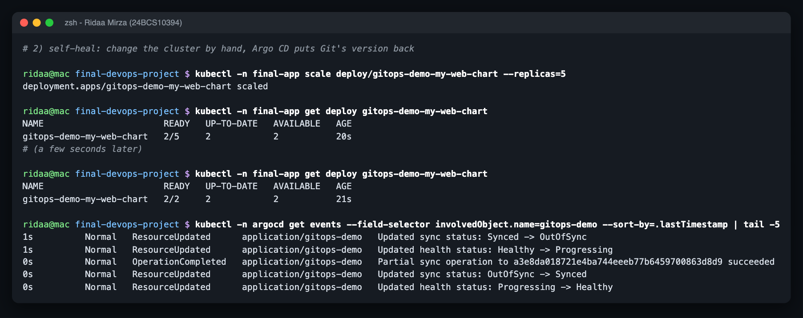

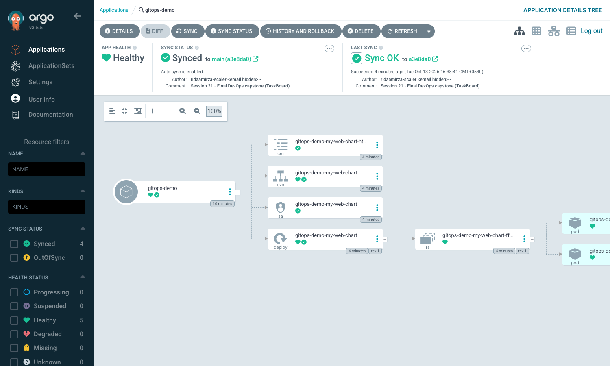

The real Application right now says what it should - the path isn't on GitHub yet:

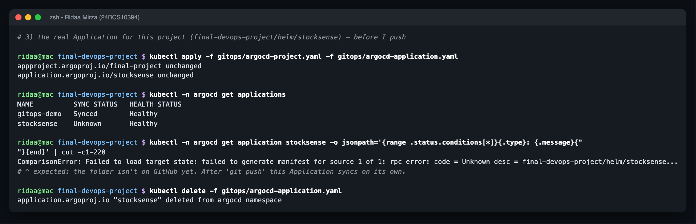

> TODO (after you push): put a CI-built SHA into `argocd-application.yaml`, make the GHCR packages public, apply it and screenshot `stocksense Synced Healthy`.

---

## 13. Troubleshooting

Full write-up with broken/fixed YAML and screenshots: **[troubleshooting/README.md](troubleshooting/README.md)**.

| # | What broke | Symptom | Root cause | Fix |
|---|---|---|---|---|
| 1 | backend image tag `1.0.1` | `Init:ImagePullBackOff`, rollout stuck (old pods kept serving) | tag never built/loaded | `rollout undo` + correct tag |
| 2 | frontend Service selector typo | 503 on `/` | Service had no endpoints | fix selector |
| 3 | DB password changed in Secret | new pods stuck in init, `password authentication failed` | Secret != password stored in Postgres | restore Secret, restart |
| 4 | ConfigMap key renamed | `CreateContainerConfigError` | `configMapKeyRef` to a missing key | restore key |
| 5 | Ingress `/api` -> port 8080 | 503 on `/api` | Service only exposes 8000 (the reference chart's bug) | port 8000 |
| 6 | backend `resources` removed | HPA `<unknown>/60%`, `missing request for cpu` | utilisation is a % of the request | restore requests |
| 7 | **real, not planted**: Grafana | restart loop, then the API server stalled | liveness probe shorter than startup; no CPU limit | longer probe delay, CPU limit |

I also documented the bugs I found in the reference TaskBoard project before reusing its structure (Terraform that doesn't parse, Ingress pointing at a wrong Service name/port, hard-coded nginx upstream, `latest` npm deps, root nginx, upper-case GHCR owner):

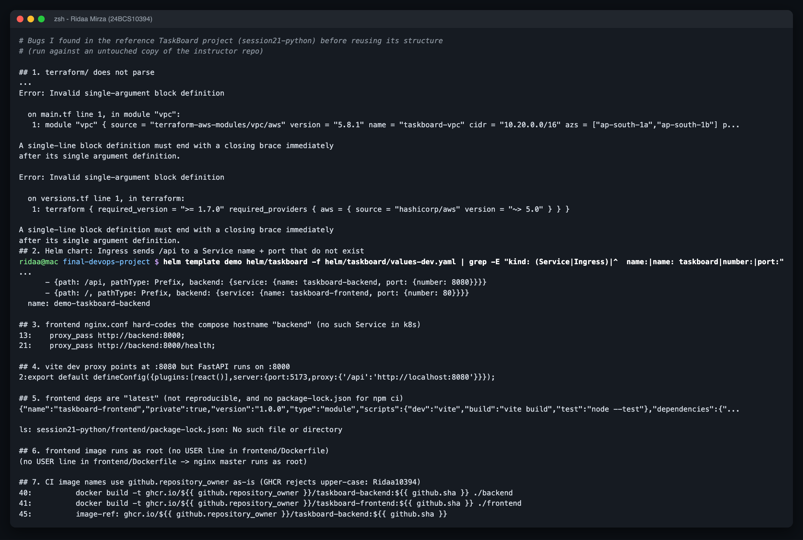

---

## 14. Screenshots

Browser:

| | |
|---|---|
| App (Docker Compose) | [01-app-docker-compose.png](screenshots/01-app-docker-compose.png) |
| App at phone width | [02-app-mobile.png](screenshots/02-app-mobile.png) |
| Swagger `/docs` | [03-api-swagger-docs.png](screenshots/03-api-swagger-docs.png) |
| App through the Kubernetes Ingress | [04-app-k8s-ingress.png](screenshots/04-app-k8s-ingress.png) |
| Prometheus Targets (5/5 UP) | [06-prometheus-targets.png](screenshots/06-prometheus-targets.png) |
| Grafana dashboard with live data | [07-grafana-dashboard.png](screenshots/07-grafana-dashboard.png) |
| Argo CD application tree | [08-argocd-gitops-demo.png](screenshots/08-argocd-gitops-demo.png) |

Terminal (rendered from `outputs/*.txt`): `screenshots/10-*.png` to `46-*.png` (embedded in the sections above) and `troubleshooting/screenshots/` (embedded in the troubleshooting README).

Still to capture (need a push or AWS - see section 17):

- **TODO** GitHub Actions green run (all 9 stages) + the Trivy step log from a pipeline run
- **TODO** GHCR package page with `stocksense-backend` / `stocksense-frontend` SHA tags
- **TODO** commit history (10+ commits)
- **TODO** `terraform plan` output, AWS console VPC + EKS, `terraform destroy`
- **TODO** Argo CD `stocksense` Application Synced/Healthy
- **TODO** live demo / recording: commit a change -> pipeline -> deployment updates

---

## 15. Lessons learned

- **The symptom is never where the problem is.** A 503 was a label typo; `<unknown>` in the HPA was a missing resource request; a stuck rollout was a password. Events, endpoints and init-container logs found them, not the app logs.
- **Liveness vs readiness matters.** My readiness checks the DB, liveness doesn't - otherwise a DB outage would restart every backend pod for nothing. And a liveness probe that's tighter than real startup time turns "slow" into "never" (Grafana did exactly that to me).
- **`maxUnavailable: 0` saved the app** in three of the scenarios - the new pods were broken, the old ones kept serving.
- **Scanners find things in code you didn't write.** The HIGH CVEs weren't in my dependencies - they were inside pip and the nginx base image. Removing what you don't need at runtime is the best fix.
- **One gate, one policy file** is much easier to reason about than `--exit-code` flags scattered across jobs, and "a missing report = fail" stops a silently-skipped scan from passing.
- **Limits protect neighbours.** One pod without a CPU limit stalled the whole shared cluster's API server.
- **Reference code isn't automatically correct.** The TaskBoard Terraform didn't parse and its Ingress pointed at a Service that didn't exist - running everything for real is the only way to know.
- **GitOps flips the direction.** CI pushes images; the cluster pulls config from Git. Self-heal reverting my manual `kubectl scale` in a second made that click.
- Small practical ones: GHCR needs lower-case names; `*.localhost` saves editing `/etc/hosts`; Docker Hub rate limits are real (I fell back to `mirror.gcr.io` and the classic builder); `envFrom` ignores missing keys but `configMapKeyRef` doesn't.

---

## 16. Rubric checklist (GRADING.md M1-M10)

Paths are relative to the repo root (the rubric's `backend/`, `frontend/`, `k8s/` map to `application/backend/`, `application/frontend/`, `kubernetes/`).

| Module | Criterion | Where / evidence | Status |
|---|---|---|---|
| **M1** App (10) | FastAPI `/health` | `application/backend/app/main.py`, [15-compose-api-crud](screenshots/15-compose-api-crud.png) | done |
| | >= 4 REST endpoints GET/POST/PUT/DELETE | 10 endpoints, section 1, `outputs/docker-compose-api-tests.txt` | done |
| | Postgres + Alembic migration | `alembic/versions/0001_create_items.py`, `0002_seed_items.py`, [16](screenshots/16-compose-proxy-db-nonroot.png) | done |
| | React frontend calls the API | `application/frontend/src/`, [01](screenshots/01-app-docker-compose.png) | done |
| | Responsive, usable UI | [02-app-mobile](screenshots/02-app-mobile.png) | done |
| **M2** Testing (10) | pytest runs clean | [10-ruff-pytest](screenshots/10-ruff-pytest.png) (19 passed, 97.67%) | done |
| | >= 5 tests, >= 3 endpoints | 19 tests over health/ready/metrics/items CRUD/adjust/stats | done |
| | test DB / mock, not prod | `tests/conftest.py` (SQLite override, `TEST_DATABASE_URL` for throwaway Postgres), [11](screenshots/11-pytest-postgres.png) | done |
| | pytest.ini / conftest.py | `application/backend/pytest.ini`, `tests/conftest.py` | done |
| **M3** Git (5) | public repo | https://github.com/Ridaa10394/devops-project | done |
| | meaningful commits | **TODO** commit the project in small, descriptive commits | TODO |
| | .gitignore (.env, __pycache__, node_modules, .venv) | `.gitignore` (repo root) | done |
| | commit history screenshot (10+) | **TODO** after pushing | TODO |
| **M4** Docker (10) | backend Dockerfile builds | `application/backend/Dockerfile`, [13](screenshots/13-docker-build.png) | done |
| | frontend multi-stage (Node -> Nginx) | `application/frontend/Dockerfile` | done |
| | non-root images | UID 10001 / 101, [13](screenshots/13-docker-build.png), [16](screenshots/16-compose-proxy-db-nonroot.png) | done |
| | compose starts all 3 | `docker/docker-compose.yml`, [14](screenshots/14-compose-up.png) | done |
| **M5** CI/CD (15) | workflow file | `../.github/workflows/final-project.yml` (copy in `.github/workflows/`) | done |
| | triggers on push to main | `on.push.branches: [main]` + paths filter | done |
| | pytest job fails the build | `backend-test` job, `--cov-fail-under=80` | done |
| | frontend built in pipeline | `frontend-build` job | done |
| | images for both built | `docker-build` matrix | done |
| | pushed to GHCR | `push` job | **TODO** run URL + GHCR screenshot after push |
| | SHA tags, not latest | `:${GITHUB_SHA}` only | done |
| **M6** Trivy (5) | Trivy on both images in CI | `image-scan` matrix job | done |
| | fail on HIGH/CRITICAL | `--exit-code 1 --severity HIGH,CRITICAL --ignore-unfixed` + gate | done |
| | explain a CVE / result | section 10 + [security/README.md](security/README.md), local output [20](screenshots/20-trivy-image.png) | done (**TODO** pipeline-run screenshot) |
| **M7** Terraform (15) | valid HCL | `terraform/*.tf`, [23](screenshots/23-terraform-init-validate.png) | done |
| | init OK | [23](screenshots/23-terraform-init-validate.png) | done |
| | plan non-empty | needs AWS credentials, [24](screenshots/24-terraform-plan-no-credentials.png) | **TODO** |
| | VPC with 2+ public subnets | `main.tf` module "vpc" | code done, **TODO** apply + console screenshot |
| | EKS + node group | `main.tf` module "eks" | code done, **TODO** apply + console screenshot |
| | destroy cleanly | | **TODO** |
| | terraform.tfvars.example | `terraform/terraform.tfvars.example` | done |
| **M8** K8s + Helm (15) | namespace manifest | `kubernetes/00-namespace.yaml` | done |
| | Helm chart (Chart.yaml, values, templates) | `helm/stocksense/` | done |
| | helm upgrade --install works | [33](screenshots/33-helm-install.png), [35](screenshots/35-helm-test.png) | done |
| | backend + frontend >= 2 replicas | [34](screenshots/34-helm-get-all.png) | done |
| | ClusterIP Services | [34](screenshots/34-helm-get-all.png) | done |
| | Ingress `/` -> frontend, `/api` -> backend | `templates/ingress.yaml`, [31](screenshots/31-k8s-ingress-curl.png), [37](screenshots/37-helm-ingress-crud.png), [04](screenshots/04-app-k8s-ingress.png) | done |
| | all pods Running, `helm list` | [33](screenshots/33-helm-install.png), [34](screenshots/34-helm-get-all.png) | done |
| **M9** Observability (10) | `/metrics` Prometheus format | [38](screenshots/38-metrics-endpoint.png) | done |
| | Prometheus scraping the app | [06](screenshots/06-prometheus-targets.png), [41](screenshots/41-prometheus-targets-cli.png) | done |
| | Grafana installed + accessible | [40](screenshots/40-monitoring-install.png), [07](screenshots/07-grafana-dashboard.png) | done |
| | panel with live app metrics | [07-grafana-dashboard](screenshots/07-grafana-dashboard.png) | done |
| **M10** Docs + demo (5) | README explaining the app | this file | done |
| | live demo: commit -> pipeline -> deploy | | **TODO** presentation |
| Extra (homework doc) | DevSecOps gate, GitOps, troubleshooting challenge, HPA load test | sections 10, 12, 13, 7 | done |

---

## 17. TODO - what I still have to do on my machine

Nothing here was faked; these steps need things this laptop session didn't have (AWS credentials, a `git push`).

**1. Commit and push** (M3, M5, M10)

```bash
cd ~/Desktop/AI-Labs/devops-project
# commit in groups, e.g. git add application/backend && git commit -m "..."
# a few meaningful commits rather than one, e.g.:
#   "Final project: StockSense FastAPI backend with Alembic migrations and tests"
#   "Final project: React frontend and multi-stage Dockerfiles"
#   "Final project: Kubernetes manifests, Helm chart, monitoring and GitOps"
#   "Final project: CI/CD pipeline with DevSecOps gate"
#   "Final project: Terraform VPC + EKS, troubleshooting challenge, README"
git push origin main
```

Screenshot: `git log --oneline | head -15` and the commit list on GitHub.

**2. Pipeline + GHCR** (M5, M6)

- GitHub -> Actions -> "Final Project - StockSense CI/CD" -> the run for your push. Screenshot the graph with all jobs green and copy the run URL into this README.
- Open job "6. Trivy image scan (backend)" -> step "Enforce - fail on fixable HIGH/CRITICAL" -> screenshot the table.
- GitHub profile -> Packages -> `stocksense-backend` and `stocksense-frontend` -> screenshot the version list showing the SHA tag. While there: Package settings -> Change visibility -> Public (needed for Argo CD/EKS to pull without a secret).
- If code scanning isn't enabled, the SARIF upload steps just warn (`continue-on-error`).

**3. Terraform on AWS** (M7) - costs roughly $0.15/hour while it exists:

```bash
cd devops-project/terraform
cp terraform.tfvars.example terraform.tfvars
# set cluster_admin_cidrs = ["<your IP>/32"]   (curl -s https://checkip.amazonaws.com)
aws configure          # or aws sso login
terraform init
terraform plan -out tfplan       # screenshot "Plan: N to add"
terraform apply tfplan           # ~15 min
$(terraform output -raw configure_kubectl) && kubectl get nodes
```

Screenshots: AWS Console -> VPC -> Your VPCs (`stocksense-dev-vpc`, 4 subnets) and EKS -> Clusters (`stocksense-dev-eks`, Active, node group). Optionally deploy the chart there with `values-prod.yaml` and the CI SHA. Then:

```bash
terraform destroy                # screenshot "Destroy complete!"
```

**4. Argo CD with the real Application** (GitOps): edit `gitops/argocd-application.yaml` -> `global.imageTag` = the pushed SHA, then `kubectl apply -f gitops/argocd-project.yaml -f gitops/argocd-application.yaml`, screenshot `kubectl -n argocd get applications` (stocksense Synced/Healthy) and the UI tree.

**5. Live demo** (M10): change something small (e.g. the dashboard title in `App.jsx`), commit, push, show the pipeline running, the new SHA tag in GHCR, and the deployment updating (kind in CI, or Argo CD after updating the tag).
