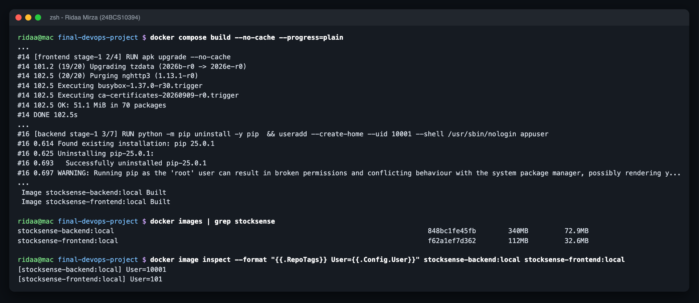
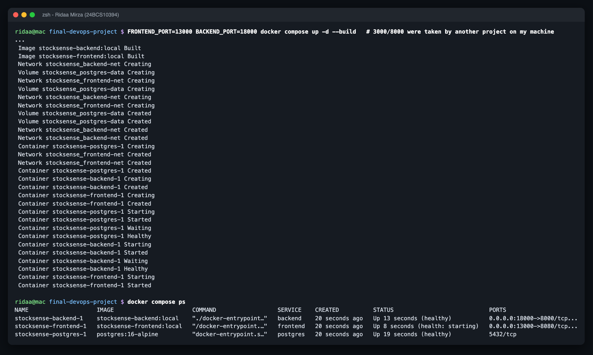
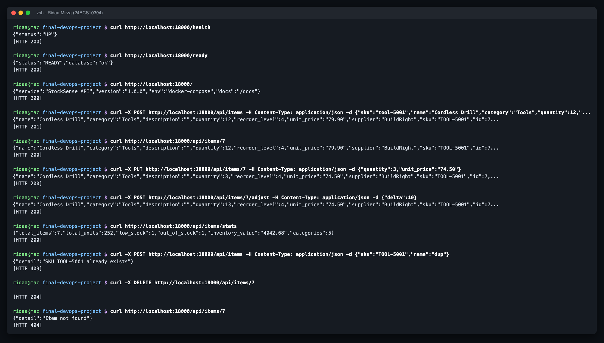
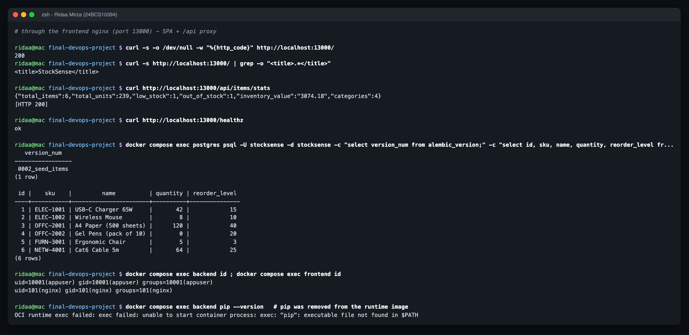
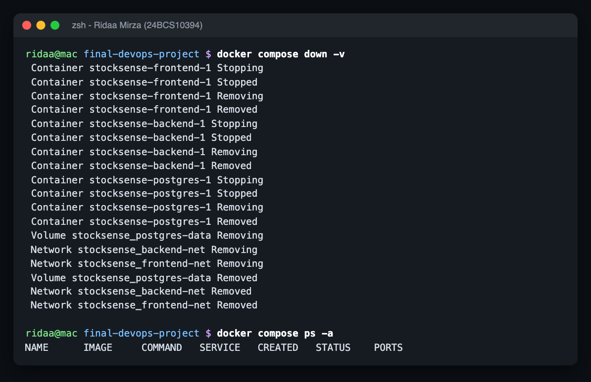
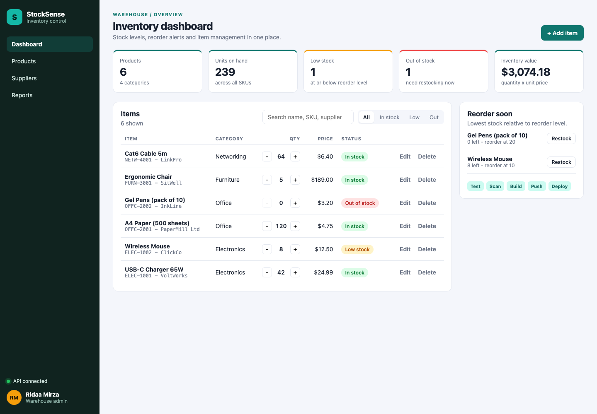

# Docker - StockSense images + local stack

Name: Ridaa Mirza
Enrollment No: 24BCS10394

The Dockerfiles live next to the code they build (that's what the CI build context needs):

| Image | Dockerfile | Base | Runs as | Size |
|---|---|---|---|---|
| `stocksense-backend` | `../application/backend/Dockerfile` | `python:3.12-slim`, 2 stages (venv builder -> slim runtime) | UID 10001 | 340 MB (72.9 MB compressed) |
| `stocksense-frontend` | `../application/frontend/Dockerfile` | `node:22-alpine` build -> `nginxinc/nginx-unprivileged:1.29-alpine` runtime | UID 101 | 112 MB (32.6 MB compressed) |

This folder holds the compose file that runs the whole thing.

## Run it

```bash
cd devops-project/docker
docker compose up -d --build
# UI   http://localhost:3000
# API  http://localhost:8000/docs   /health   /ready   /metrics
docker compose down -v      # -v also deletes the postgres volume
```

On my laptop 3000 and 8000 were already taken by another project's containers (`Bind for 0.0.0.0:8000 failed: port is already allocated`), so I made the host ports variables:

```bash
FRONTEND_PORT=13000 BACKEND_PORT=18000 docker compose up -d --build
```

## What's in the compose file

```
            frontend-net                    backend-net
  browser -> frontend (nginx :8080) --/api--> backend (FastAPI :8000) --> postgres (:5432)
             host :3000                       host :8000                  no host port
```

- `postgres` has a `pg_isready` healthcheck and is only on `backend-net` - the frontend container can't even resolve it.
- `backend` waits for `postgres: service_healthy`, then its entrypoint runs `wait_for_db` -> `alembic upgrade head` -> `exec uvicorn`.
- `frontend` waits for `backend: service_healthy` (the backend image has a `HEALTHCHECK` that hits `/health`).
- The frontend's nginx config is a template: `BACKEND_URL` is substituted at container start, so the same image works in compose (`http://backend:8000`) and Kubernetes (`http://stocksense-backend:8000`).
- Credentials come from `docker/.env` if present (see `.env.example`), with local-only defaults otherwise.

## Things I fixed / added compared to the reference TaskBoard Dockerfiles

- Frontend runtime was `nginx:alpine` running as root -> switched to `nginx-unprivileged` (UID 101, port 8080).
- Frontend used `npm install` with `"latest"` versions -> pinned versions + `package-lock.json` + `npm ci`, so the build is reproducible.
- nginx proxied to a hard-coded `http://backend:8000` -> env-var template.
- Backend: two stages, and **pip removed from the runtime image**. Trivy found HIGH CVEs in pip's vendored `urllib3`/`msgpack` (see `../outputs/security-gate-run1-failed.txt`); nothing installs packages at runtime, so pip doesn't need to be there.
- Frontend: `apk upgrade` in the runtime stage, because the base image lagged behind Alpine security fixes (42 fixable HIGH CVEs in curl/libcrypto3/c-ares before, 0 after).
- Healthchecks in both images, OCI labels, `.dockerignore` files so tests, `.venv`, `node_modules` and `.env` never end up in the build context.

## Proof

- `../outputs/docker-build.txt` - full `docker compose build --no-cache` log (incl. the `pip uninstall` and `apk upgrade` steps) + image sizes + `User=10001` / `User=101`
- `../outputs/docker-compose-up.txt` - all three containers created, postgres and backend `Healthy`
- `../outputs/docker-compose-api-tests.txt` - every endpoint (GET/POST/PUT/DELETE/adjust/stats, 409 + 404 paths), the UI + `/api` through nginx, `/metrics`, the `items` table inside postgres, `id` in both containers (non-root), `pip` not found in the backend runtime
- `../outputs/docker-compose-down.txt`
- `../screenshots/01-app-docker-compose.png`, `02-app-mobile.png`, `03-api-swagger-docs.png`

## Terminal screenshots












