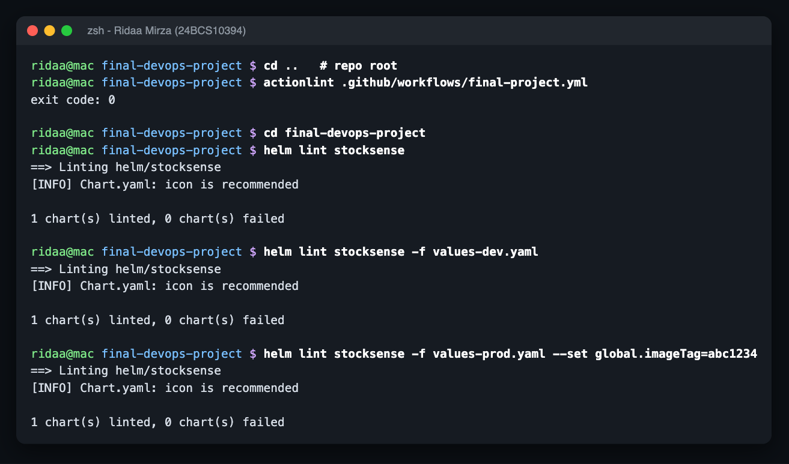
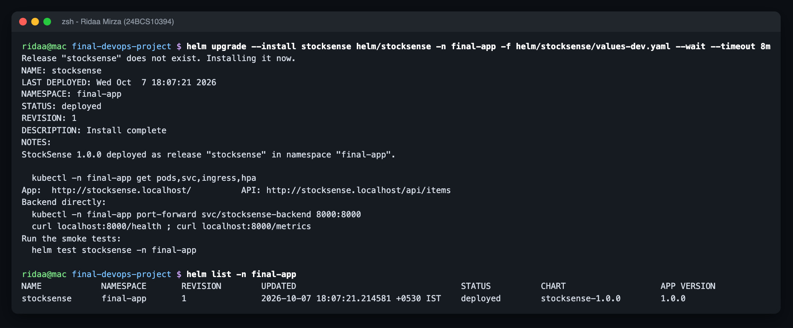
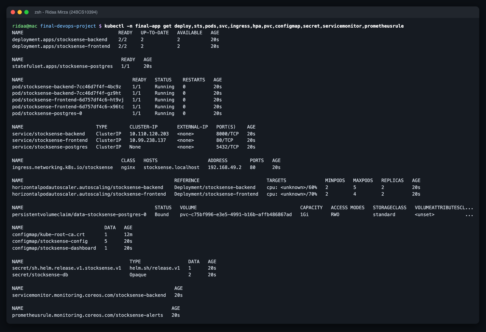
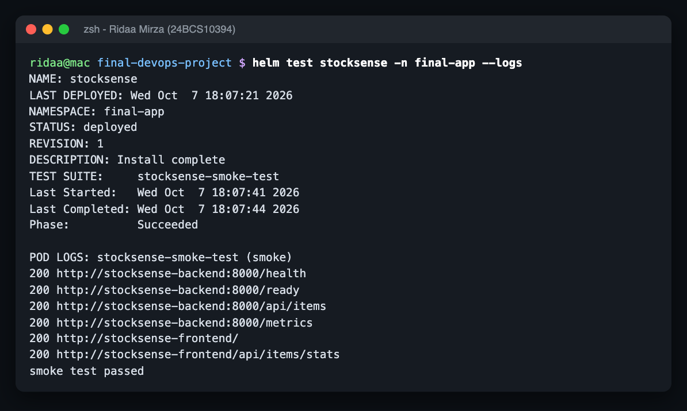
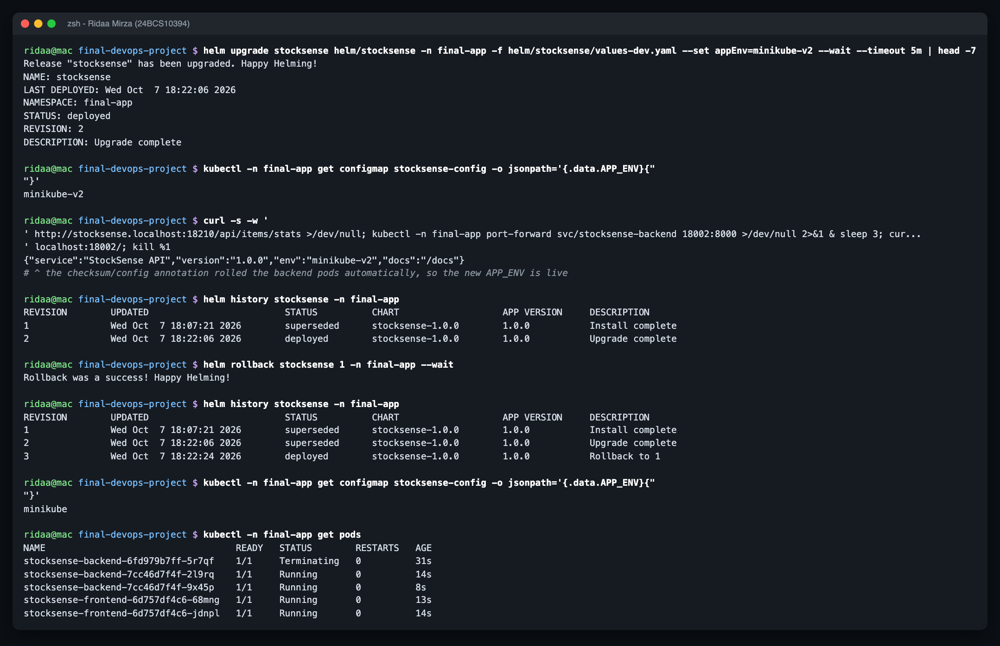

# Helm - `stocksense` chart

Name: Ridaa Mirza
Enrollment No: 24BCS10394

One chart deploys the whole app: Postgres (StatefulSet + PVC), backend, frontend, ConfigMap, Secret, Services, Ingress, two HPAs, and optionally a ServiceMonitor, PrometheusRule and Grafana dashboard ConfigMap.

```
helm/stocksense/
├── Chart.yaml
├── values.yaml          # defaults (GHCR images, tag = global.imageTag or appVersion)
├── values-dev.yaml      # minikube: local images 1.0.0, monitoring objects on
├── values-prod.yaml     # EKS: existingSecret, gp3 storage, TLS ingress, bigger HPA ranges
├── files/grafana-dashboard.json      # copy of ../monitoring/grafana-dashboard.json (CI checks they match)
└── templates/
    ├── _helpers.tpl     # names, labels, selector, image, secret name, db host
    ├── configmap.yaml   secret.yaml   postgres.yaml   backend.yaml   frontend.yaml
    ├── ingress.yaml     hpa.yaml      servicemonitor.yaml   prometheusrule.yaml
    ├── grafana-dashboard.yaml        NOTES.txt
    └── tests/test-smoke.yaml         # `helm test`: health, ready, items, metrics, frontend, /api proxy
```

Things I did on purpose:

- **Selector labels come from one helper** (`stocksense.selector`), used by the Deployment, its Service and the ServiceMonitor. A label typo can't break only one of them (that's troubleshooting scenario 2).
- **The Ingress takes its port from `.Values.backend.port`**, the same value as the Service, so the reference chart's `/api -> :8080` bug (scenario 5) can't happen.
- **Secret password**: `existingSecret` for real environments; otherwise a random 20-char password that `lookup` keeps stable across `helm upgrade` (it doesn't rotate on every upgrade and lock the app out of its own DB - scenario 3).
- **`checksum/config` + `checksum/secret` pod annotations** roll the pods when config changes.
- **CI sets one value**: `--set global.imageTag=<git sha>` picks both images.

## Commands

```bash
helm lint helm/stocksense -f helm/stocksense/values-dev.yaml
helm template stocksense helm/stocksense -f helm/stocksense/values-prod.yaml --set global.imageTag=abc1234

helm upgrade --install stocksense helm/stocksense -n final-app --create-namespace \
  -f helm/stocksense/values-dev.yaml --wait
helm test stocksense -n final-app --logs
helm history stocksense -n final-app
helm rollback stocksense 1 -n final-app
```











Rendered manifests: `../outputs/helm-template-dev.yaml`, `../outputs/helm-template-prod.yaml`.
