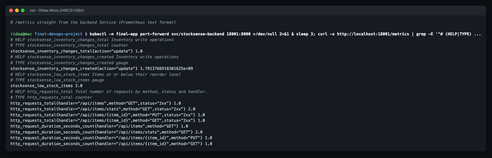
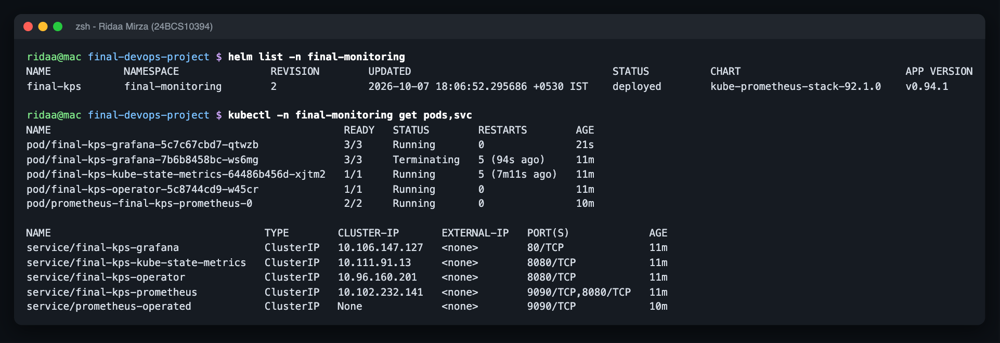
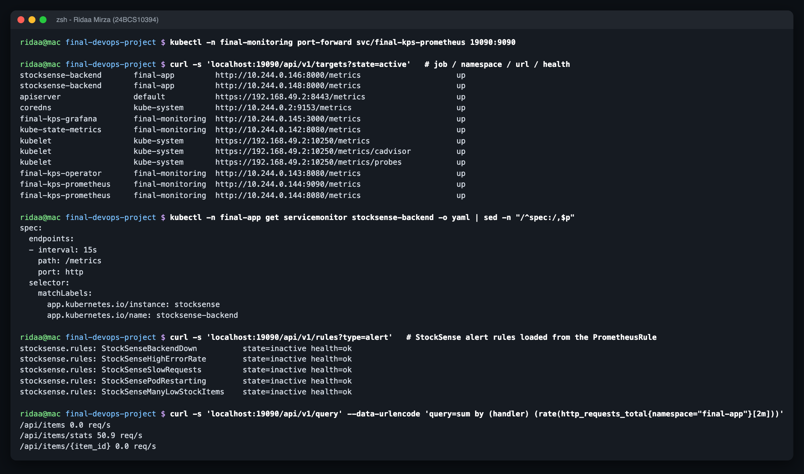
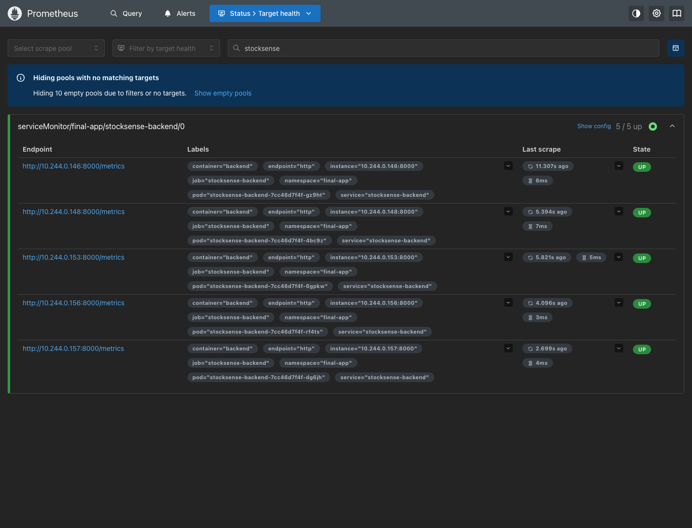
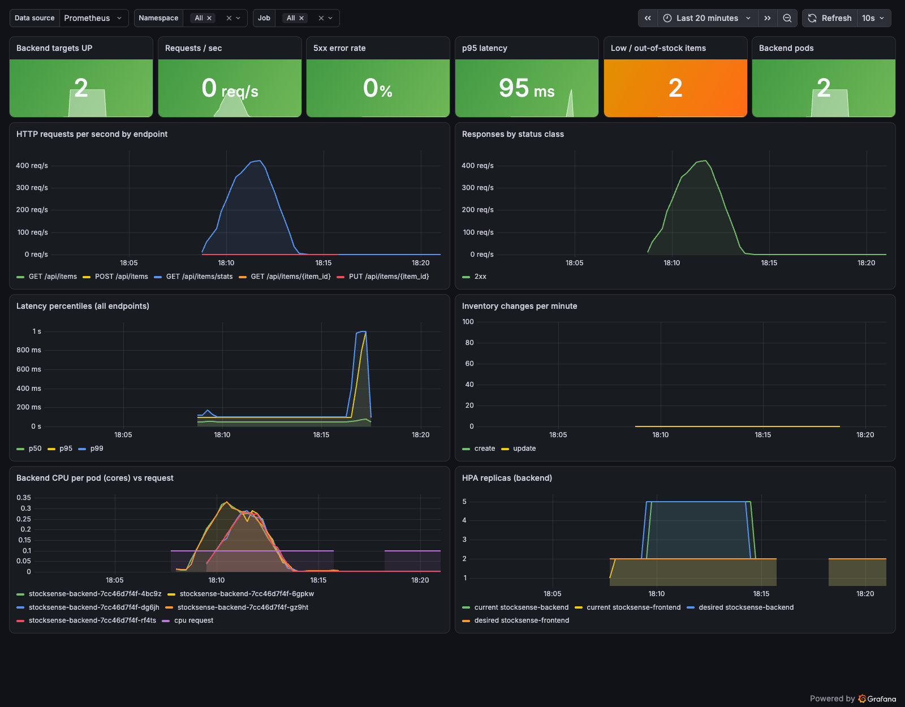

# Monitoring - Prometheus + Grafana

Name: Ridaa Mirza
Enrollment No: 24BCS10394

| File | What |
|---|---|
| `prometheus-values.yaml` | kube-prometheus-stack values (Prometheus, Grafana, kube-state-metrics, operator; lean for minikube) |
| `servicemonitor.yaml` | scrape `stocksense-backend` Service, port `http`, `/metrics`, every 15s |
| `prometheus-rules.yaml` | 5 alerts: BackendDown, HighErrorRate (>5% 5xx), SlowRequests (p95 > 500ms), PodRestarting, ManyLowStockItems |
| `grafana-dashboard.json` | "StockSense - Application Overview": targets up, req/s, 5xx %, p95, low-stock gauge, pods, req/s per endpoint, status classes, p50/p95/p99, inventory changes, CPU per pod vs request, HPA replicas |

The Helm chart renders the same ServiceMonitor, rules and dashboard (`monitoring.*.enabled=true` in `values-dev.yaml`); the dashboard reaches Grafana through the sidecar (label `grafana_dashboard: "1"`, `searchNamespace: ALL`).

## What the app exposes

`prometheus-fastapi-instrumentator` gives `http_requests_total{handler,method,status}` and `http_request_duration_seconds_*`; I added two business metrics: `stocksense_inventory_changes_total{action}` (create/update/restock/ship/delete) and `stocksense_low_stock_items`.



## Install

```bash
helm repo add prometheus-community https://prometheus-community.github.io/helm-charts
helm upgrade --install final-kps prometheus-community/kube-prometheus-stack --version 92.1.0 \
  -n final-monitoring --create-namespace -f monitoring/prometheus-values.yaml --wait --timeout 12m
kubectl -n final-monitoring port-forward svc/final-kps-prometheus 19090:9090
kubectl -n final-monitoring port-forward svc/final-kps-grafana 13001:80
kubectl -n final-monitoring get secret final-kps-grafana -o jsonpath='{.data.admin-password}' | base64 -d
```

`serviceMonitorSelectorNilUsesHelmValues: false` + `serviceMonitorNamespaceSelector: {}` matter: without them Prometheus only picks up ServiceMonitors labelled with its own release name, and the app's target silently never appears.

Grafana gave me real trouble on the shared minikube (liveness probe killing it mid-startup, then ~3.8 cores with no CPU limit stalling the API server) - written up as troubleshooting scenario 7; the probe and limit fixes are in `prometheus-values.yaml`.





Prometheus Targets page - all 5 backend pods UP while the HPA had scaled out:



Grafana during/after the HPA load test (traffic peak ~420 req/s, CPU per pod way above the 100m request, HPA 2 -> 5 -> 2; the gap around 18:16 is the API-server stall from scenario 7):


