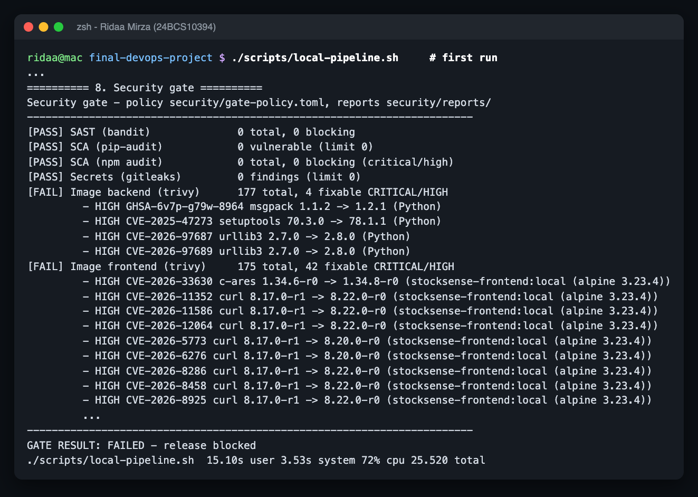
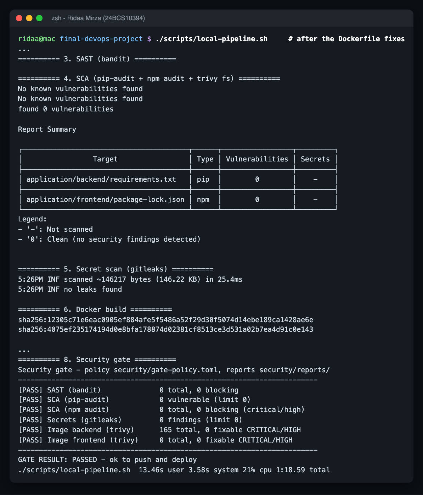
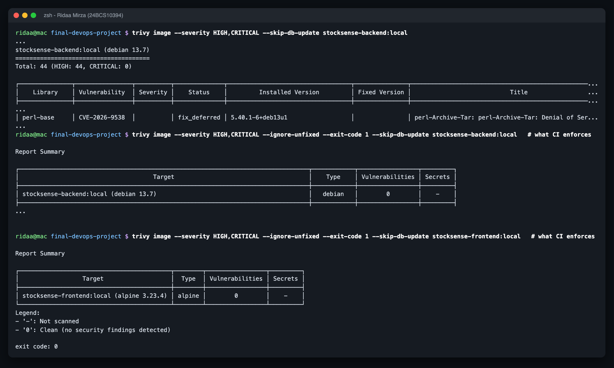
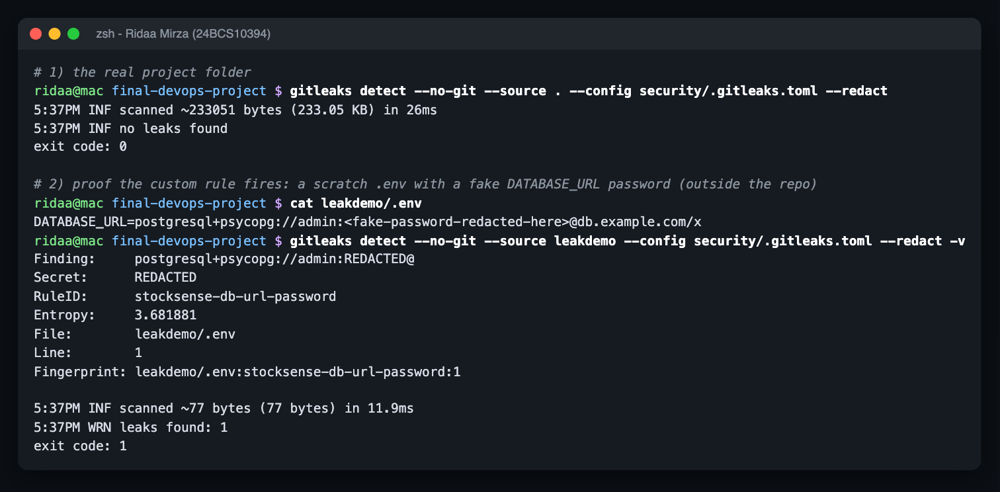

# DevSecOps - scanners, policy and the security gate

Name: Ridaa Mirza
Enrollment No: 24BCS10394

| Layer | Tool | Config | Scans |
|---|---|---|---|
| SAST | bandit 1.9.4 | `bandit.yaml` | `application/backend/app` + `alembic` |
| SCA (Python) | pip-audit 2.10.1 | - | `requirements.txt` (pinned) |
| SCA (npm) | npm audit | - | `package-lock.json` |
| SCA + secrets in files | trivy fs 0.75.0 | `trivy.yaml` | lockfiles |
| IaC misconfig | trivy config | - | Dockerfiles, k8s YAML, Helm, Terraform (report only) |
| Secrets | gitleaks 8.30.1 | `.gitleaks.toml` | whole project, default rules + 1 custom rule |
| Container images | trivy image | `trivy.yaml`, `.trivyignore` | OS + Python/npm packages in both images |
| **Gate** | `gate.py` | `gate-policy.toml` | reads all JSON reports, one pass/fail |

How it fits together: every scanner runs in *report mode* and writes JSON into `reports/`. `gate.py` then applies `gate-policy.toml`:

- bandit: block MEDIUM+ severity with MEDIUM+ confidence
- pip-audit: block any known vuln (0 allowed)
- npm audit: block high/critical
- gitleaks: block any finding
- trivy image: block HIGH/CRITICAL **that have a fix**; unfixed ones are reported, not blocking
- a missing report is a FAIL (a scan that silently didn't run must not count as a pass)

In CI there is also an explicit `trivy image --severity HIGH,CRITICAL --ignore-unfixed --exit-code 1` step per image, so the image-scan job itself goes red too.

Run everything locally exactly like CI: `./scripts/local-pipeline.sh`

## The gate actually caught something

The first full run **failed**:

- Backend: 4 fixable HIGH in Python packages - but not mine. They were pip's own vendored `urllib3`, `msgpack` and `setuptools` (`pip/_vendor`) in the base image. Nothing installs packages at runtime, so the fix was to **uninstall pip from the runtime image**.
- Frontend: 42 fixable HIGH in Alpine packages (curl, libcrypto3, c-ares...) - the `nginx-unprivileged` base image lagged behind Alpine's security releases. Fix: `apk upgrade --no-cache` in the runtime stage.

Second run:

### What Trivy scanned and what the result means (M6 write-up)

Trivy scanned both final images layer by layer: the OS packages (Debian 13 for the backend, Alpine 3.23 for the frontend) and the language packages it found inside (the Python venv, and nothing extra in the nginx image). After the fixes there are **0 fixable HIGH/CRITICAL** findings in either image, so the gate passes. The backend still shows 44 HIGH in Debian packages that have **no fixed version yet** - e.g. `CVE-2026-9538` in `perl-base` (a denial-of-service via a crafted tar header in `Archive::Tar`, status `fix_deferred` by Debian). My app never runs Perl or unpacks tar files, there's nothing to upgrade to, so it's reported and tracked instead of blocking; when Debian ships a fix, the next build picks it up and the gate would start enforcing it.

## Secrets

`.gitleaks.toml` extends the default rules with one custom rule for Postgres URLs that contain an inline password (placeholders like `change-me` are allow-listed). The project scan is clean, and I proved the rule fires on a scratch file outside the repo:

What keeps real secrets out of Git: `.env` / `terraform.tfvars` / tfstate are gitignored, only `.env.example` and `terraform.tfvars.example` are committed, the k8s Secret in `kubernetes/02-secret.yaml` holds an obviously fake dev-only value, and `values-prod.yaml` uses `auth.existingSecret` (created out-of-band). CI only uses the built-in `GITHUB_TOKEN`.

## IaC scan

`trivy config` first flagged the Postgres StatefulSet (default security context, writable root fs) - I fixed it (runs as UID 70, read-only root fs, emptyDirs for the socket and /tmp). It also flagged `0.0.0.0/0` access to the EKS API - fixed by making `cluster_admin_cidrs` required and rejecting `0.0.0.0/0`. The two that remain are accepted: public EKS endpoint (restricted to my IP) and node egress to anywhere (nodes need to pull images).

Reports: `reports/` is regenerated on every run (gitignored); the curated text output is in `../outputs/` (`local-pipeline.txt`, `security-gate-run1-failed.txt`, `trivy-image-*.txt`, `trivy-config-iac.txt`, `gitleaks.txt`).
