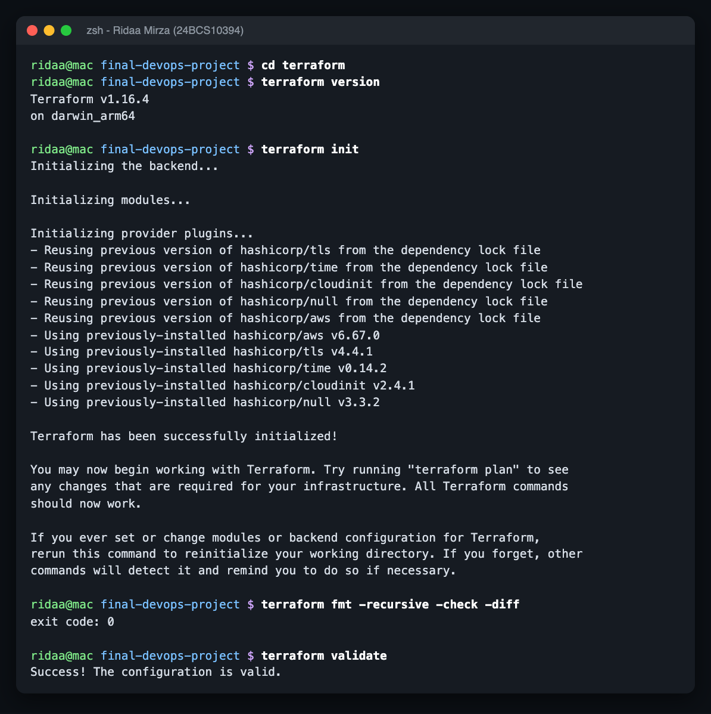
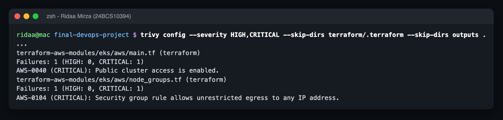

# Terraform - AWS VPC + EKS for StockSense

Name: Ridaa Mirza
Enrollment No: 24BCS10394

```
AWS ap-south-1
└── VPC 10.42.0.0/16  (terraform-aws-modules/vpc 6.7.3)
    ├── public subnets   10.42.0.0/24, 10.42.1.0/24   (2 AZs, IGW, tagged kubernetes.io/role/elb)
    ├── private subnets  10.42.10.0/24, 10.42.11.0/24 (tagged internal-elb)
    ├── 1 NAT gateway (single_nat_gateway = true -> cheaper)
    └── EKS "stocksense-dev-eks" 1.33  (terraform-aws-modules/eks 21.26.0)
        ├── addons: coredns, kube-proxy, vpc-cni, pod-identity-agent, metrics-server (HPA)
        └── managed node group "default": t3.medium, min 1 / desired 2 / max 3, SPOT in dev
```

| File | What |
|---|---|
| `versions.tf` | Terraform >= 1.6, AWS provider ~> 6.0, default tags (Project/Owner/ManagedBy), S3 backend block (commented) |
| `variables.tf` | region, names, CIDRs, AZ count (validated 2-3), k8s version, node sizes, `cluster_admin_cidrs` (**no default**, rejects 0.0.0.0/0) |
| `main.tf` | VPC + EKS modules |
| `outputs.tf` | VPC/subnet IDs, cluster name/endpoint, ready-to-paste `aws eks update-kubeconfig` command |
| `terraform.tfvars.example` | copy to `terraform.tfvars` (gitignored) - no credentials in it |
| `.terraform.lock.hcl` | provider versions pinned (committed on purpose) |

Why VPC + EKS and not just EC2: the rubric wants the app on Kubernetes in AWS. I kept it cheap - one NAT gateway, spot nodes in dev, 2 small nodes. EKS control plane + NAT is roughly $0.15/hour, so it's apply -> use -> destroy, not leave-running.

I fixed the reference project's Terraform first - it doesn't even parse (single-line blocks with several arguments), see `../outputs/reference-bugs-found.txt`.

## Validation

`init`, `fmt` and `validate` all pass (CI runs the same checks in job 1c):



`trivy config` (IaC scan) flags two things in the EKS module, both accepted on purpose: public API endpoint (restricted by `cluster_admin_cidrs` to my IP) and unrestricted node egress (nodes have to pull images).



## Running it on AWS

```bash
aws configure                        # or aws sso login
cd devops-project/terraform
cp terraform.tfvars.example terraform.tfvars
# edit cluster_admin_cidrs = ["<your public IP>/32"]   (curl -s https://checkip.amazonaws.com)
terraform init
terraform plan -out tfplan           # "Plan: N to add, 0 to change, 0 to destroy"
terraform apply tfplan               # ~15 min for EKS
$(terraform output -raw configure_kubectl)
kubectl get nodes                    # VPC stocksense-dev-vpc, EKS cluster stocksense-dev-eks
helm upgrade --install stocksense ../helm/stocksense -n stocksense --create-namespace \
  -f ../helm/stocksense/values-prod.yaml --set global.imageTag=<sha from CI> \
  --set auth.existingSecret=""       # or create the stocksense-db Secret first
terraform destroy                    # "Destroy complete! Resources: N destroyed."
```
