# Final Troubleshooting Challenge

Name: Ridaa Mirza
Enrollment No: 24BCS10394

For the challenge I took the working StockSense deployment in the `final-app` namespace on minikube (the raw manifests from `../kubernetes/`) and broke it on purpose, six different ways. Then a seventh problem showed up by itself while I was installing monitoring, so that one is in here too, because it was the most "real" one of the lot.

Every scenario follows the same loop:

```
break -> notice the symptom -> look at pods / events / logs / endpoints -> find the root cause -> fix -> verify
```

How the folder is laid out:

```
troubleshooting/
├── broken/    # the manifest with exactly one thing wrong (marked "# BROKEN")
├── fixed/     # the same object, correct (identical to the file in ../kubernetes/)
└── outputs/   # the full real terminal session for each scenario
```

Everything below was run against the live cluster. The logs in `outputs/` are the untouched terminal output (the only edit is a note in scenario 3 where I removed a check that turned out to prove nothing - explained there).

Setup before breaking anything:

```bash
kubectl apply -k kubernetes/
kubectl -n ingress-nginx port-forward svc/ingress-nginx-controller 18210:80 &
curl -s http://stocksense.localhost:18210/api/items/stats     # 200, app healthy
```

### Summary

| # | What I broke | Symptom | Where the answer was | Fix |
|---|---|---|---|---|
| 1 | Backend image tag `1.0.0` -> `1.0.1` | `Init:ImagePullBackOff`, rollout stuck | `kubectl describe pod` events | `kubectl rollout undo` + correct tag in Git |
| 2 | Frontend Service selector typo | Ingress returns **503** on `/` | Service has no endpoints | Fix selector to `app: stocksense-frontend` |
| 3 | DB password in the Secret changed | New backend pods stuck in `Init:Error` / restart loop | `migrate` init container logs + postgres logs | Put the right password back, restart |
| 4 | ConfigMap key renamed | Frontend pod `CreateContainerConfigError` | Pod events: `couldn't find key BACKEND_URL` | Restore the key |
| 5 | Ingress points `/api` at port 8080 | **503** on `/api`, `/` still fine | `describe ingress` shows no endpoints for that port | Port 8000 |
| 6 | Backend `resources` removed | HPA `cpu: <unknown>/60%`, never scales | `describe hpa`: `missing request for cpu` | Put requests back |
| 7 | (real, not planted) Grafana liveness probe + no CPU limit | Grafana restart loop, `helm --wait` timed out, later the API server stalled | `kubectl top` + events + probe config | Longer liveness delay, CPU limit |

One thing I noticed in scenarios 1, 3 and 4: because my Deployments use `maxUnavailable: 0`, the old pods kept serving the whole time the new ones were broken. The app never went down - only the rollout got stuck. That's exactly why the rolling update settings matter.

---

## Scenario 1 - Bad image tag -> ImagePullBackOff

**Broken** (`broken/1-bad-image-tag.yaml`), same change in the initContainer and the main container:

```yaml
      initContainers:
        - name: migrate
          image: stocksense-backend:1.0.1 # BROKEN
      containers:
        - name: backend
          image: stocksense-backend:1.0.1 # BROKEN: tag that was never built/loaded
```

**Fixed** (`fixed/1-bad-image-tag.yaml`): `image: stocksense-backend:1.0.0`

### Identify

```bash
kubectl apply -f troubleshooting/broken/1-bad-image-tag.yaml
kubectl -n final-app rollout status deploy/stocksense-backend --timeout=60s
# error: timed out waiting for the condition
kubectl -n final-app get pods -l app=stocksense-backend
```

```
NAME                                  READY   STATUS                  RESTARTS   AGE
stocksense-backend-59496b7dbd-6sqfg   1/1     Running                 0          3m42s
stocksense-backend-59496b7dbd-c2v5w   1/1     Running                 0          3m42s
stocksense-backend-868b6d849b-5mh4q   0/1     Init:ImagePullBackOff   0          60s
```

It says `Init:` because the very first container in the pod (the `migrate` init container) already can't be pulled.

### Investigate

```bash
kubectl -n final-app describe pod stocksense-backend-868b6d849b-5mh4q
```

```
Failed to pull image "stocksense-backend:1.0.1": failed to pull and unpack image
"docker.io/library/stocksense-backend:1.0.1": ... pull access denied, repository does not exist
or may require authorization
Warning  Failed  Error: ErrImagePull
Normal   BackOff Back-off pulling image "stocksense-backend:1.0.1"
```

### Root cause

`1.0.1` was never built or loaded into minikube. Since it's not on the node, the kubelet tries Docker Hub (`docker.io/library/stocksense-backend`), which doesn't exist -> `ErrImagePull`, and after a few tries `ImagePullBackOff` (it waits longer and longer between retries).

### Fix + verify

```bash
kubectl -n final-app rollout undo deploy/stocksense-backend      # fastest way back
kubectl apply -f troubleshooting/fixed/1-bad-image-tag.yaml       # make the applied config match too
kubectl -n final-app rollout status deploy/stocksense-backend
# deployment "stocksense-backend" successfully rolled out
curl -s http://stocksense.localhost:18210/api/items/stats         # HTTP 200
```

`rollout undo` warned that the `last-applied-configuration` annotation would now be out of date, which is why I re-applied the fixed file right after. In the real pipeline this can't really happen, because CI tags images with the commit SHA and only deploys tags it just pushed.

Terminal (real output from `outputs/`):

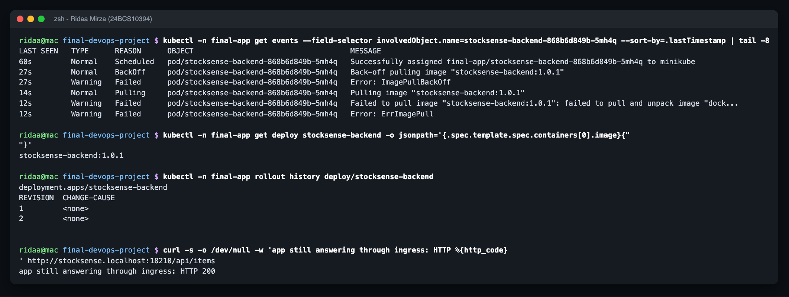

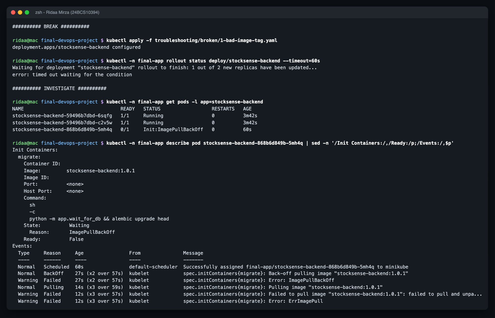

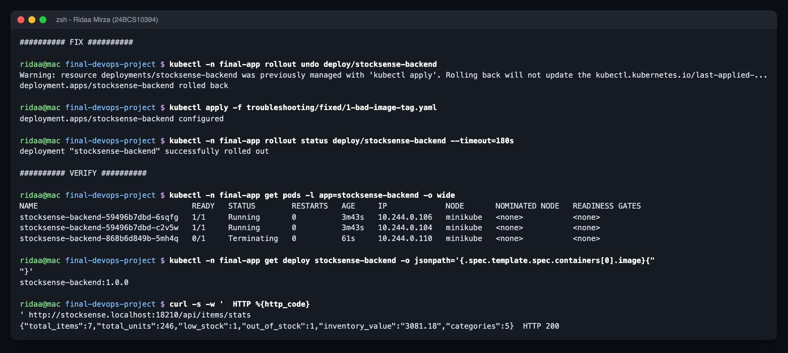

Full log: `outputs/1-bad-image-tag.txt`

---

## Scenario 2 - Service selector mismatch -> no endpoints -> 503

**Broken:**

```yaml
spec:
  type: ClusterIP
  selector: {app: stocksense-fronted} # BROKEN: typo, matches no pod
```

**Fixed:** `selector: {app: stocksense-frontend}`

### Identify

```bash
curl -s -w '\nHTTP %{http_code}\n' http://stocksense.localhost:18210/
# HTTP 503
curl -s -o /dev/null -w '%{http_code}\n' http://stocksense.localhost:18210/api/items
# 200   <- only the frontend route is broken
```

The pods themselves were completely fine (`1/1 Running`), which is what makes this one confusing at first.

### Investigate

```bash
kubectl -n final-app get svc stocksense-frontend -o wide
kubectl -n final-app get endpointslices -l kubernetes.io/service-name=stocksense-frontend
kubectl -n final-app get pods --show-labels | grep frontend
kubectl -n ingress-nginx logs deploy/ingress-nginx-controller --since=60s | grep stocksense-frontend
```

```
stocksense-frontend   ClusterIP   10.97.175.187   80/TCP   app=stocksense-fronted
stocksense-frontend-w9rjw   IPv4   <unset>   <unset>                         <- zero endpoints
... app=stocksense-frontend,pod-template-hash=6b5c74ccc8                        <- real pod label
Service "final-app/stocksense-frontend" does not have any active Endpoint.
"GET / HTTP/1.1" 503 ...
```

### Root cause

A Service finds its pods only through the label selector. `stocksense-fronted` matches nothing, so the Service has no endpoints and ingress-nginx has nowhere to send the request -> 503.

### Fix + verify

```bash
kubectl apply -f troubleshooting/fixed/2-service-selector-mismatch.yaml
kubectl -n final-app get endpointslices -l kubernetes.io/service-name=stocksense-frontend
# stocksense-frontend-w9rjw   IPv4   8080   10.244.0.103,10.244.0.105
curl -s -o /dev/null -w '%{http_code}\n' http://stocksense.localhost:18210/     # 200
```

In the Helm chart the Service selector and the pod labels both come from the same helper (`stocksense.selector`), so this typo can't happen there.

Terminal (real output from `outputs/`):

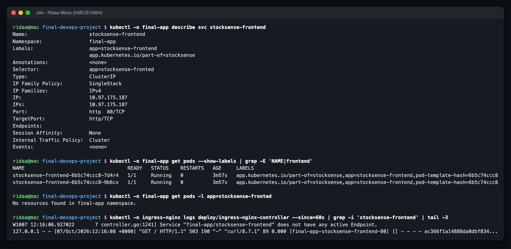

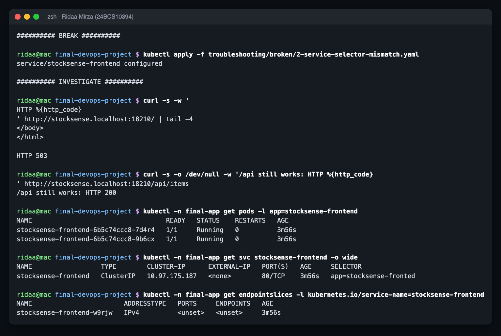

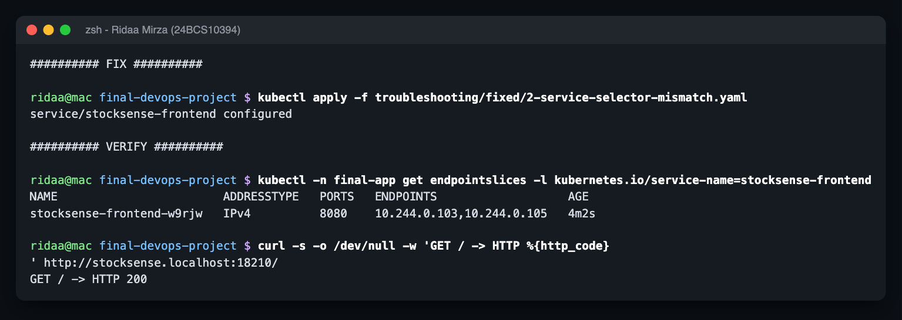

Full log: `outputs/2-service-selector-mismatch.txt`

---

## Scenario 3 - Wrong DB password in the Secret -> init container keeps failing

**Broken:**

```yaml
stringData:
  DB_USER: "stocksense"
  DB_PASSWORD: "local-minikube-0nly" # BROKEN: does not match what postgres was initialised with
```

**Fixed:** the original value from `kubernetes/02-secret.yaml`.

This one copies a really common mistake: someone "rotates" the password in the Secret, but Postgres only reads `POSTGRES_PASSWORD` the first time it creates the data directory, so the database still has the old one.

```bash
kubectl apply -f troubleshooting/broken/3-wrong-db-password.yaml
kubectl -n final-app rollout restart deploy/stocksense-backend     # env vars are only read at pod start
```

### Identify

```
NAME                                  READY   STATUS     RESTARTS      AGE
stocksense-backend-59496b7dbd-6sqfg   1/1     Running    0             5m49s
stocksense-backend-59496b7dbd-c2v5w   1/1     Running    0             5m49s
stocksense-backend-5fbc895fdb-dvztv   0/1     Init:0/1   1 (32s ago)   95s
```

### Investigate

```bash
kubectl -n final-app logs stocksense-backend-5fbc895fdb-dvztv -c migrate --tail=6
```

```
[15/30] database not ready: connection failed: connection to server at "10.244.0.107", port 5432
failed: FATAL:  password authentication failed for user "stocksense"
```

```bash
kubectl -n final-app describe pod stocksense-backend-5fbc895fdb-dvztv    # migrate: Last State Terminated, Exit Code 1
kubectl -n final-app logs stocksense-postgres-0 | grep 'password authentication failed'
```

```
FATAL:  password authentication failed for user "stocksense"
DETAIL:  Connection matched file ".../pg_hba.conf" line 128: "host all all all scram-sha-256"
```

So both sides agree: the network is fine and the database is up, but the credentials are wrong.

### Root cause

The Secret's `DB_PASSWORD` doesn't match the password stored inside Postgres. My `wait_for_db.py` retries 30 times (60 seconds) and then exits 1, so the init container fails and the kubelet restarts it with backoff. It never gets to the main container, and the pod never becomes Ready.

A note on honesty here: I first tried `psql -h 127.0.0.1` with the wrong password *inside* the postgres pod to prove it fails - and it worked. The official image's `pg_hba.conf` trusts connections from 127.0.0.1, so that test proves nothing. I left a note about it in the output log instead of pretending.

### Fix + verify

```bash
kubectl apply -f troubleshooting/fixed/3-wrong-db-password.yaml
kubectl -n final-app rollout restart deploy/stocksense-backend
kubectl -n final-app rollout status deploy/stocksense-backend
kubectl -n final-app logs <new-pod> -c migrate
# database reachable after 1 attempt(s)
curl -s http://stocksense.localhost:18210/api/items/stats     # HTTP 200
```

To actually rotate a password you have to change it in both places: `ALTER USER stocksense PASSWORD '...'` in Postgres first, then the Secret, then restart. (In the Helm chart I also put a `checksum/secret` annotation on the pods, so a Secret change rolls them automatically instead of needing a manual restart.)

Terminal (real output from `outputs/`):

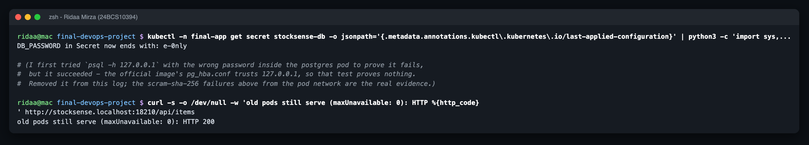

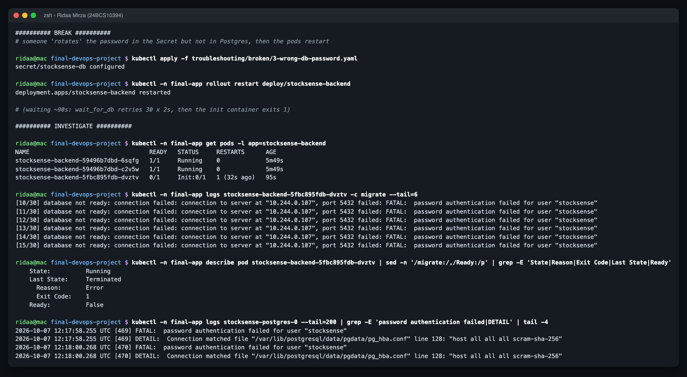

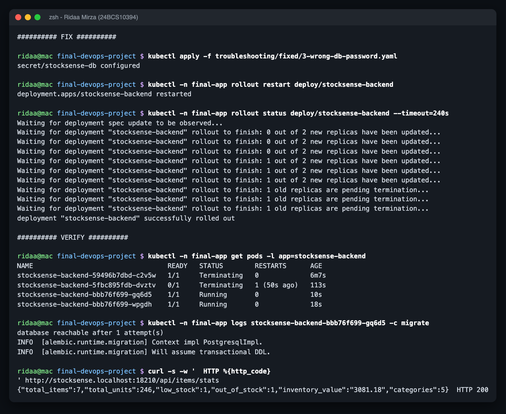

Full log: `outputs/3-wrong-db-password.txt`

---

## Scenario 4 - Missing ConfigMap key -> CreateContainerConfigError

**Broken:**

```yaml
data:
  ...
  BACKEND_ADDR: "http://stocksense-backend:8000" # BROKEN: key renamed, frontend still asks for BACKEND_URL
```

**Fixed:** `BACKEND_URL: "http://stocksense-backend:8000"`

The frontend reads that key with `configMapKeyRef`:

```yaml
env:
  - name: BACKEND_URL
    valueFrom: {configMapKeyRef: {name: stocksense-config, key: BACKEND_URL}}
```

### Identify

```bash
kubectl apply -f troubleshooting/broken/4-missing-configmap-key.yaml
kubectl -n final-app rollout restart deploy/stocksense-frontend
kubectl -n final-app get pods -l app=stocksense-frontend
```

```
stocksense-frontend-fd4f66768-4bdx5    0/1     CreateContainerConfigError   0          20s
```

### Investigate

```bash
kubectl -n final-app logs stocksense-frontend-fd4f66768-4bdx5
# Error from server (BadRequest): container "frontend" ... is waiting to start: CreateContainerConfigError
kubectl -n final-app get events --field-selector involvedObject.name=stocksense-frontend-fd4f66768-4bdx5
# Warning  Failed  Error: couldn't find key BACKEND_URL in ConfigMap final-app/stocksense-config
kubectl -n final-app get configmap stocksense-config -o jsonpath='{.data}'
# {"APP_ENV":"kubernetes","BACKEND_ADDR":"http://stocksense-backend:8000",...}
```

`kubectl logs` is useless here because the container never started - the events have the answer.

### Root cause

The kubelet builds the container's environment before starting it. A `configMapKeyRef` to a key that doesn't exist (and isn't marked `optional: true`) is a hard error, so the container is never created.

(Fun detail: the backend uses `envFrom` for the whole ConfigMap, and `envFrom` does *not* fail on missing keys - it would have started and then failed in a much more confusing way at runtime.)

### Fix + verify

```bash
kubectl apply -f troubleshooting/fixed/4-missing-configmap-key.yaml
kubectl -n final-app rollout status deploy/stocksense-frontend
# deployment "stocksense-frontend" successfully rolled out
curl -s -o /dev/null -w '%{http_code}\n' http://stocksense.localhost:18210/    # 200
```

I didn't even have to delete the stuck pod - the kubelet keeps retrying, and once the key was back it started on its own (`fd4f66768-4bdx5` went to Running).

Terminal (real output from `outputs/`):

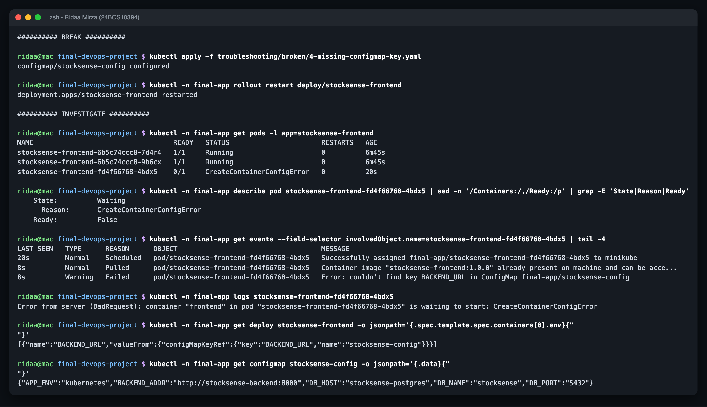

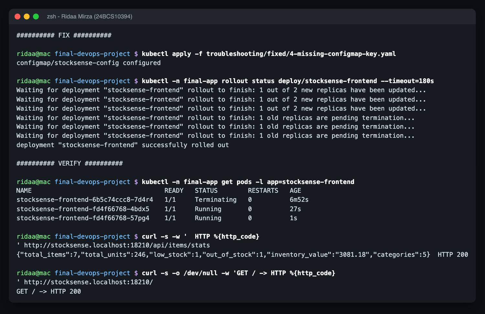

Full log: `outputs/4-missing-configmap-key.txt`

---

## Scenario 5 - Ingress points at the wrong Service port -> 503 on /api

**Broken:**

```yaml
          - path: /api
            pathType: Prefix
            backend:
              service: {name: stocksense-backend, port: {number: 8080}} # BROKEN: Service listens on 8000
```

**Fixed:** `port: {number: 8000}`

I picked this one because it's the actual bug I found in the reference TaskBoard chart (its Ingress sends `/api` to `taskboard-backend:8080`, but the Service is `<release>-taskboard-backend` on port 8000).

### Identify

```bash
curl -s -w '\nHTTP %{http_code}\n' http://stocksense.localhost:18210/api/items/stats    # HTTP 503
curl -s -o /dev/null -w '%{http_code}\n' http://stocksense.localhost:18210/             # 200
```

### Investigate

```bash
kubectl -n final-app describe ingress stocksense
```

```
  stocksense.localhost
                        /api   stocksense-backend:8080 ()
                        /      stocksense-frontend:80 (10.244.0.125:8080,10.244.0.126:8080)
```

The empty `()` is the giveaway: no endpoints for that service+port.

```bash
kubectl -n final-app get svc stocksense-backend               # 8000/TCP
kubectl -n final-app get endpointslices -l kubernetes.io/service-name=stocksense-backend
# stocksense-backend-kmdxk   IPv4   8000   10.244.0.121,10.244.0.122     <- pods are fine
kubectl -n ingress-nginx logs deploy/ingress-nginx-controller --since=60s | grep stocksense-backend
# "GET /api/items/stats" 200 ... [final-app-stocksense-backend-8000]   <- before
# "GET /api/items/stats" 503 ... [final-app-stocksense-backend-8080]   <- after
```

### Root cause

The Ingress backend port has to be a port the **Service** exposes (8000), not some other number. There is no 8080 on that Service, so the upstream `final-app-stocksense-backend-8080` is empty and nginx answers 503.

### Fix + verify

```bash
kubectl apply -f troubleshooting/fixed/5-ingress-wrong-port.yaml
kubectl -n final-app describe ingress stocksense | grep /api
#   /api   stocksense-backend:8000 (10.244.0.121:8000,10.244.0.122:8000)
curl -s http://stocksense.localhost:18210/api/items/stats     # HTTP 200
```

In my Helm chart the Ingress takes the port from `.Values.backend.port`, the same value the Service uses, so the two can't drift apart.

Terminal (real output from `outputs/`):

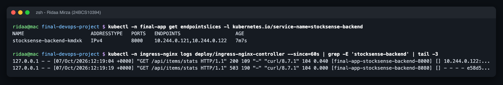

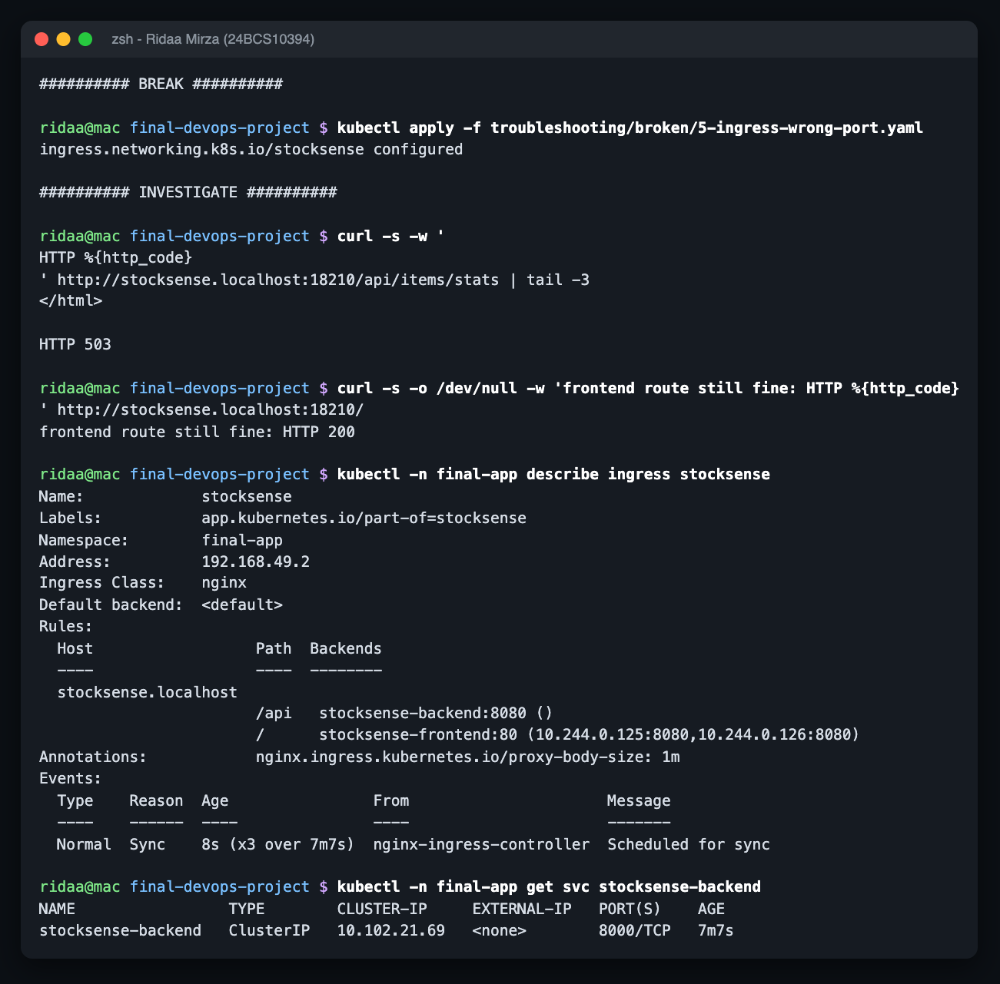

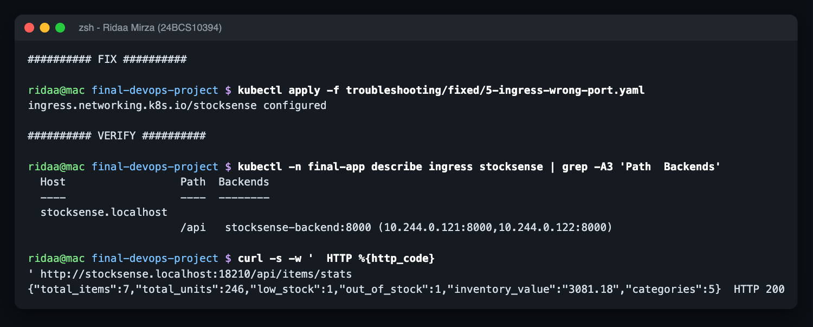

Full log: `outputs/5-ingress-wrong-port.txt`

---

## Scenario 6 - HPA with no resource requests -> `<unknown>` targets

**Broken** - the whole `resources` block removed from the backend container:

```yaml
          # BROKEN: resources block removed - no cpu request, so the HPA has nothing to compute a percentage against
```

**Fixed:**

```yaml
          resources:
            requests: {cpu: 100m, memory: 128Mi}
            limits: {cpu: 500m, memory: 256Mi}
```

### Identify

```bash
kubectl -n final-app get hpa stocksense-backend
```

```
stocksense-backend   Deployment/stocksense-backend   cpu: <unknown>/60%   2   5   2   11m
```

### Investigate

```bash
kubectl -n final-app describe hpa stocksense-backend
```

```
ScalingActive  False  FailedGetResourceMetric  the HPA was unable to compute the replica count:
failed to get cpu utilization: missing request for cpu in container backend of Pod stocksense-backend-59fd545649-z25qd
```

```bash
kubectl top pods -n final-app -l app=stocksense-backend
# stocksense-backend-59fd545649-8m74j   2m   66Mi       <- metrics-server is fine
```

My first attempt only waited 45 seconds and the HPA said `did not receive metrics for targeted pods` instead - that's just metrics-server not having samples for brand new pods yet. Waiting until it had data gave the real message above.

### Root cause

`averageUtilization: 60` means "60% **of the CPU request**". With no request there is nothing to divide by, so the HPA refuses to scale at all - even under heavy load it would sit at 2 replicas.

### Fix + verify

```bash
kubectl apply -f troubleshooting/fixed/6-hpa-no-resource-requests.yaml
kubectl -n final-app get hpa stocksense-backend
# stocksense-backend   Deployment/stocksense-backend   cpu: 2%/60%   2   5   2   13m
kubectl -n final-app describe hpa stocksense-backend | grep ScalingActive
# ScalingActive   True    ValidMetricFound ...
```

After this I ran the load test against the Helm release to prove the HPA really scales (see `../outputs/hpa-load-test.txt`).

Terminal (real output from `outputs/`):

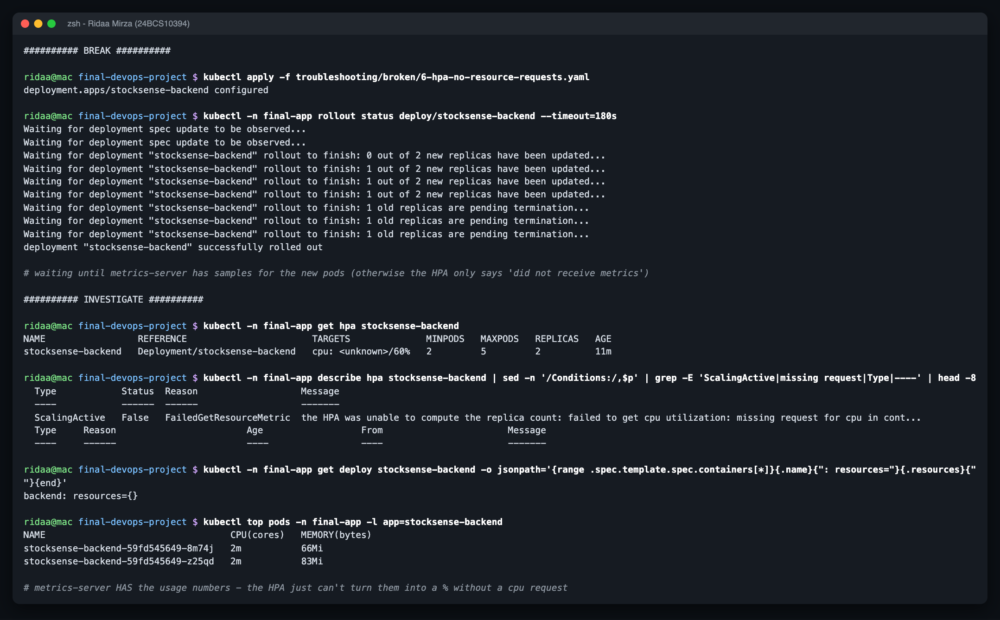

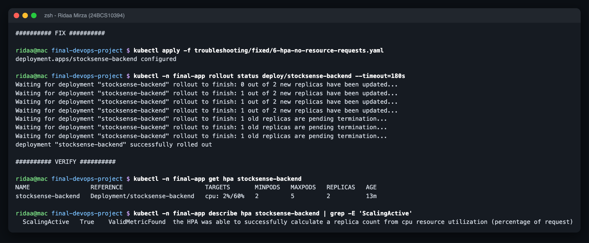

Full log: `outputs/6-hpa-no-resource-requests.txt`

---

## Scenario 7 (found for real) - Grafana stuck in a liveness restart loop

I didn't plant this one. Installing kube-prometheus-stack with `helm --wait --timeout 10m` failed:

```
Error: resource Deployment/final-monitoring/final-kps-grafana not ready. status: InProgress, message: Available: 0/1
context deadline exceeded
```

### Investigate

```bash
kubectl -n final-monitoring get pods
# final-kps-grafana-7b6b8458bc-ws6mg    2/3   Running   5 (35s ago)   10m
kubectl top pods -n final-monitoring
# final-kps-grafana-7b6b8458bc-ws6mg    2178m   369Mi       <- 2 full cores
kubectl -n final-monitoring get events --field-selector reason=Killing
# Container grafana failed liveness probe, will be restarted
kubectl -n final-monitoring describe pod -l app.kubernetes.io/name=grafana | grep Liveness
# Liveness: http-get http://:grafana/api/health delay=60s timeout=30s period=10s ...
kubectl -n final-monitoring logs deploy/final-kps-grafana -c grafana --previous --tail=15
# ... grafana-apiserver "Adding GroupVersion dashboard.grafana.app v2 ..." (still starting up)
```

### Root cause

Grafana 13 does a lot of work at startup (its embedded API server registering every dashboard API version, plus provisioning ~20 stock dashboards). On a shared 4-CPU minikube it took longer than the probe allowed, so the liveness probe killed it mid-startup, it started again from zero, got killed again... a restart loop caused by the health check itself.

### Fix + verify

In `monitoring/prometheus-values.yaml`:

```yaml
grafana:
  livenessProbe:
    httpGet: {path: /api/health, port: 3000}
    initialDelaySeconds: 300   # was 60
    timeoutSeconds: 30
    failureThreshold: 10
  readinessProbe:
    httpGet: {path: /api/health, port: 3000}
    timeoutSeconds: 5          # was 1
defaultDashboardsEnabled: false   # skip the ~20 stock dashboards, ours comes via the sidecar
```

```bash
helm upgrade --install final-kps prometheus-community/kube-prometheus-stack --version 92.1.0 \
  -n final-monitoring -f monitoring/prometheus-values.yaml --wait --timeout 12m
helm list -n final-monitoring      # STATUS deployed, REVISION 2
kubectl -n final-monitoring get pods
# final-kps-grafana-5c7c67cbd7-qtwzb   3/3   Running   0   21s
```

Lesson: a liveness probe that is stricter than the app's real worst-case startup time turns "slow" into "never". That's what `startupProbe` is for (my own backend uses one for exactly this reason).

### Part 2 - it came back, and took the API server with it

A few minutes later, while the HPA load test was running and I was logging into Grafana for the screenshot, Grafana went back up to ~3.8 cores. This time it was worse: the whole minikube API server stopped answering for about two minutes.

```
18:14:20 cpu=3822m ready/restarts=2/3 0
Error from server (Timeout): the server was unable to return a response in the time allotted ...
Unable to connect to the server: EOF
Unable to connect to the server: net/http: TLS handshake timeout
18:19:13 cpu=135m ready/restarts=1/3 1
```

The HPA events from the same minutes show it too (`etcdserver: request timed out`, `connect: connection refused` on 8443).

Root cause #2: Grafana had a memory limit but **no CPU limit**, so on a shared 4-CPU node one busy pod could starve etcd and the API server. Fix #2:

```yaml
grafana:
  resources:
    requests: {cpu: 100m, memory: 192Mi}
    limits: {cpu: "1", memory: 768Mi}
```

After `helm upgrade` (revision 3) the new Grafana pod was `3/3 Running` in 11 seconds and the node went back to ~250m CPU. Second lesson: on a shared cluster, limits aren't just about your own app - they're how you avoid taking everybody else down with you.

Terminal (real output from `outputs/`):

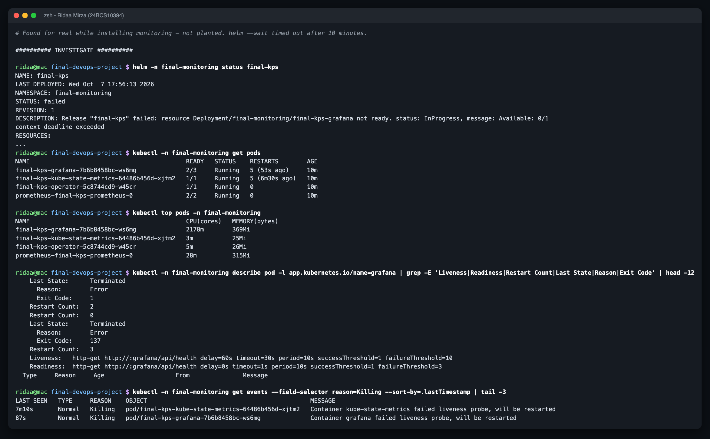

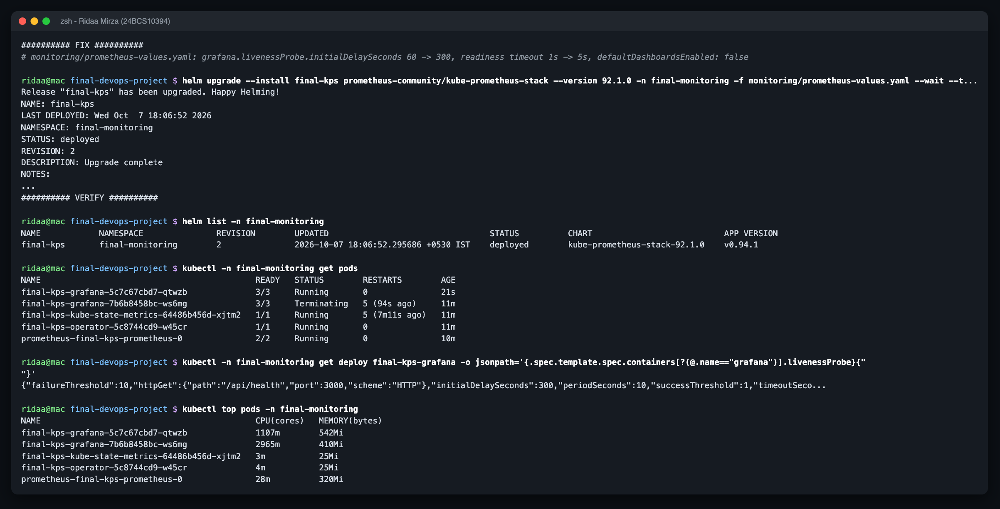

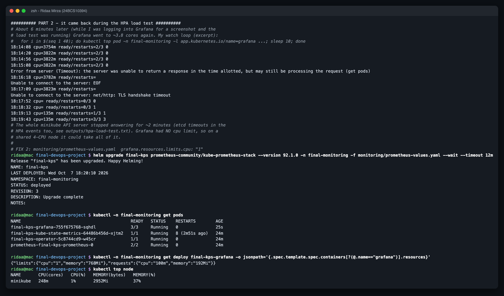

Full log: `outputs/7-grafana-liveness-restart-loop.txt`

---

## General checklist I ended up using

```
kubectl get pods                      -> which pod, which state (Pending / ImagePull / CrashLoop / ConfigError / 0/1)
kubectl describe pod <pod>            -> Events at the bottom (pull errors, probe failures, config errors)
kubectl logs <pod> [-c <container>] [--previous]
kubectl get endpointslices / svc -o wide / pods --show-labels    -> traffic problems
kubectl describe ingress / ingress-nginx logs                    -> 404 / 503 from the edge
kubectl describe hpa / kubectl top                               -> autoscaling problems
```

The biggest takeaway: the symptom you see first (503, `<unknown>`, a stuck rollout) is almost never where the problem actually is. It's always one or two hops away - a label, a key name, a port number, a password.
